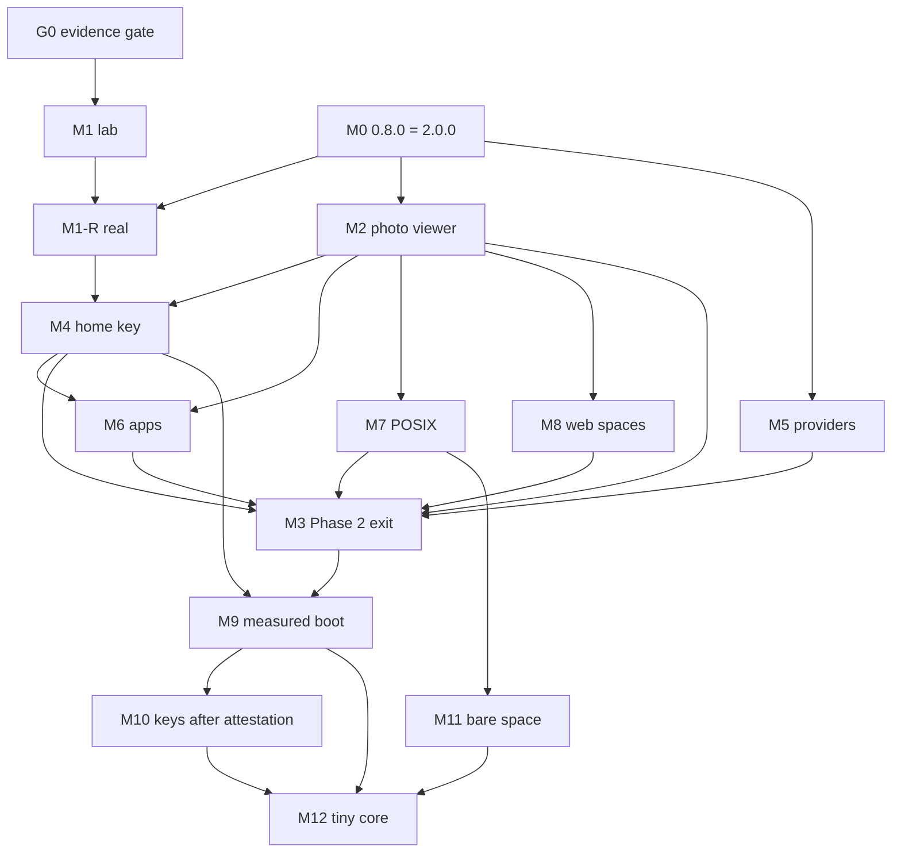

# ElastOS agent-host spike: roadmap to v3

Last updated: Wed 4 Nov 2026, about 11:30 Bangkok time (UTC+7). Base: `spike/agent-host` at `d1246b3c` (merge of #1447).

This page is for an agent or engineer arriving cold. It says where the work stands, what is done, what is moving and what is left, all the way to "v3". Every claim carries its source. Where a source does not give a stage or date, the item says **unscheduled**. Nothing here is a release date.

Rules for reading it:
- **Two counters, never added together.** *Real* means merged into [elastos/elastos-runtime](https://github.com/elastos/elastos-runtime) or shipped. *Branch* means landed on this spike repo, stand-in Runtime included. (Source: `v3-milestones-final-20261029.md` section 1.)
- A check counts only when it passes the proof standard PS1 to PS8 (section 5) and is merged.
- Status lines come from `milestones.json` (generated 31 Oct 2026, 21:20) plus the 3 and 4 Nov driver and review notes. Where they differ, the newer note wins and is cited.
- This file replaces the upstream-inherited `ROADMAP.md`. Its issue links are kept in section 4.4.

Short links used below:
- spike PR: `https://github.com/Elacity/elastos-agent-host-spike/pull/N`, written as #N
- upstream issue: `https://github.com/elastos/elastos-runtime/issues/N`, written as up#N. Old `Elacity/elastos-runtime` links redirect there.

---

## 1. Where we are now (4 Nov 2026)

### 1.1 Upstream product
- **ElastOS 2.0.0 is out.** It is the first stable release of Home, and is what upstream milestone "0.8.0" shipped as. Release: [v2.0.0](https://github.com/elastos/elastos-runtime/releases/tag/v2.0.0), source tag `v2.0.0`, commit `7bc3704b`. It runs on Apple Silicon Macs and on Linux x86-64 and ARM64, NVIDIA Jetson included. (Source: GitHub release notes.)
- It has been running on Sash's Mac since 3 Nov. (Source: 3 Nov restart state notes.)
- Known issues named in the release notes: up#515 and up#516 (fix planned for 2.0.1), up#509, up#517, up#455, Browser on Apple Silicon Macs only, up#480, up#497, up#451.
- Not done in 2.0.0, from the release notes and the 0.8.0 milestone:
  - Home can still use every app's permissions.
  - Background services run with the user account's rights.
  - Approvals have no screen that only ElastOS controls (up#173).
- Next upstream milestones: **"2.1.0"** ("Next minor release after 2.0.0", 8 open items) and **"After 0.8.0"** (the long tail; about 165 issues). See section 4.

### 1.2 This repo
- `spike/agent-host` is the main lab branch and `spike/photo-viewer` is the photo lane. As of 4 Nov, 945 PRs are merged (918 into `spike/agent-host`, 27 into `spike/photo-viewer`) and 418 are open. Merged PRs run from 21 Oct to 4 Nov.
- Latest merge: #1447 at 09:03, which frees disk on the hosted runner for `test-capsules` and so unblocks #1430.
- Rong's principles check on 4 Nov at 10:12 graded **direction C+ and overall D+**, each up half a step, with 0 Critical. The overall grade is set by the worst axis, "Review and lane process". After it, the `cx-agent-conformance` lane was stopped. (Source: `rong-20261104-1012.md`.)

### 1.3 Milestone M1 (agents as capsules, on the stand-in Runtime): 24 of 30

M1 bar, from Anders on 26 Oct: at least two concurrent DeepSeek agents do useful work through Runtime resources. Each agent has its own state, grants and budget. The run shows permitted work, denial of host secrets and of the other agent's files, cancellation, worker failure and cleanup. The demo and reviews are bound to the exact versions tested, and Sash runs it himself.

On 27 Oct, M1 was re-scoped: Runtime-blocked checks are proved against a stand-in Runtime that matches the RA specs in draft #309. The real-Runtime versions live in M1-R.

Tracks: agents 12/14, identity 2/4, confine 9/10, upstream D1 1/1, signoff 0/1.

Six checks are open:

| Check | What it needs | Status and blocker | Owner (per milestones.json) |
|---|---|---|---|
| **A5** | Each agent's journal and memory sit under its own UsersAI principal | **Blocked, but building.** Built in-house to Rong's design, with slices A5-S1 to S6. Merged so far: #1267, #1275, #1296. Open stack, in order: #1420, #1422, #1425, #1427, #1432, #1438, #1442, #1445, #1452, #1455, #1462, #1464. • #1455 was graded B- and waits behind #1452. • #1462 failed both reviews, and Rong's fixture ask is open. • #1464 slice a is built and slice b is building. A5 counts only after S5 merges with every falsifier red. The S5 evidence of record is a pasted Mac journey with a real passkey ("operator-verified on Mac, not CI-verified", grade capped at B- until I-A5-ci lands). | Anders and cx-agent-conformance |
| **A14** | Sash runs the installed demo himself, with one command on the Mac. Demo, bundle hash, Runtime hash and independent reviews are bound to one `VERSIONS.json`. | **To do.** The steps are in draft #289, with Linux dry run #405 and reviews #366, #377 and #386. | Flint and cx-agent-conformance |
| **B3** | The stand-in provider launcher builds confinement from approved declared rights for the did, wallet and model providers, and the result matches the `confine.sb` oracle. | **To do.** The B3-1a1 pieces are merged (#1297, #1305, #1309). Pieces Y50a2 and Y50b0 are open drafts (#1322, #1398, #1403, #1407, #1409). Slice plan: `a5-b3-plan-v2-20261031.md`. | Anders |
| **B4** | One typed-operations table (inputs, outputs, required right, effect) covers all three providers, and the same grant is enforced on macOS and Linux (Jetson after C9). | **In flight.** Needs C9 for the Linux half. Earlier drafts: #296, #300, #330. | agent-host lane |
| **C9** | Linux: namespaces, capability removal, seccomp and Landlock where supported. Permitted and denied operations are proven on each supported platform, and the external Linux reviewer named in the check signs off. | **In flight.** Merged: #1285, #1390, #1393, #1394, #1419. Open: #1460 (c2-ii-a, 28 lines, both families PASS, with Rong) and #1461 (c2-ii-b, 200 lines, being re-seated). | confine lane and Sash |
| **S1** | Rong's principles review grades every lane B or better | **To do. Closes last.** The latest overall grade is D+ (4 Nov 10:12). | Rong grades, Flint books |

D1 (the upstream `store.rs` patch) is done on the branch and held for upstream "after 0.8.0".

### 1.4 Other trackers

| Milestone | Today | Notes |
|---|---|---|
| **M1-R**: the same agent checks on the real Runtime | 0 of 14 | All are blocked on upstream Bus v2 (up#181) and Anders's Phase 2 work. They are void if Anders answers #309 differently. |
| **M2**: photo viewer and apps as capsules | 7 of 17 (milestones.json counts AP inside M2) | PH1–PH4, KT1, AP1 and AP2 are done. KT2 is in flight. PH5, KT3, AP5 and RA1–RA3 are blocked. PH6, AP3 and AP4 are to do. |
| **M3**: PRD Phase 2 exit | 0 of 9 | "Phase 2 starts after 0.8.0" |
| **X**: non-M1 trackers | PL1–PL7 and MP1–MP6 done | AH3 (agent grade 62/70, now 46/70), AH5, RT4 and RT5 are blocked |

v3 roadmap headline, quoted from `v3-roadmap.md` v1 (27 Oct) and not re-measured since: "about 10% proven on our branch, about 1% in the real Runtime". Rong asked that both numbers always be shown together, with lab work at half credit (`rong-v3-roadmap-20261027.md`). Since then, 2.0.0 shipping has moved stage 1 (M0); nobody has re-scored it.

---

## 2. Done (branch counter), by area

Merged PR counts by lane: grant-binding 172, confine 134, cu-bus-v2-proposal 131, cc-model-confine 69, provider 62, wasm-capsule-lab 62, ultrafast 60, cx-agent-conformance 55, cc-redteam 51, cc-capsule-identity 45, cx-wasm-audit 28, agent-host 21, plus the early `claude/*` PRs from 21 and 22 Oct. Full list: `gh pr list -R Elacity/elastos-agent-host-spike --state merged`.

### 2.1 Agent host and journal (M1 A1–A4, A6–A12, A15)
- First guest journal through the real Runtime bridge: #3 and #20 (S3 end to end). Guest-side Bus v2 proof on Wasmtime 48: #26.
- Operator ready offline in a throwaway home: #110.
- Each M1 run bound to one `VERSIONS.json`: #156.
- Each agent's memory under its own principal at home: #174.
- Fake key directory, with the probe read refused: #179. Real agent-host capsule with no grant and no journal authority: #227.
- Two resident agents, live grant view, cancel, kill, cleanup census and plan approval (A3, A6, A9–A12, A15) are proved on the stand-in. Evidence and gaps: `lab/agent-conformance/` (`RUNBOOK.md`, `GAPS.md`, `standin-runtime/`), `lab/plan-approval/`, `lab/two-capsule-run/`, `lab/useful-task/`.
- Budget (A7) on the one grant-binding ledger: #1228 and #1253.

### 2.2 Grants and allowance (grant-binding lane)
- 172 merged PRs. Recent ones: child journal keeps the issuing expiry and refuses sibling paths (#1325, #1327, #1328); rate does not spend the effect count (#1335); one overlap rule (#1415, #1416, #1417, fm3-P10).
- Evidence: `lab/grant-binding/`.

### 2.3 Signing, admission and bundles (M1 B1, B2; M2 work)
- Every stand-in launch path re-verifies the signed bundle: #1128.
- One bundle, one lab CID: #1131. `requires[].cid` refusal: #1142.
- Provider rights list and Runtime-owned rule templates (B3-1a1): #1297, #1305, #1309.

### 2.4 Provider confinement (M1 C0–C8; C9 partial)
- did-provider refuses to start without its storage root: #57. Storage error, not absence: #65. Confinement core: #66. DID verification under the profile, one path: #67.
- One bridge contract for the confined providers: #70. Model-provider profile: #88. Operations and the rights they need: #215.
- `confine.sb` is the oracle the generated profile must match: #140. Linux design for the one file-profile contract: #145.
- C9 seccomp and sibling rows: #1285, #1390, #1393, #1394, #1419. Runtime growth in this range is test-only (Rong 4 Nov).
- Files: `capsules/did-provider/` and `capsules/model-provider/` (`CONFINEMENT.md`, `confine.sb`), `lab/redteam/`.

### 2.5 Identity (A5 groundwork)
- Principal records carry a kind and the protected read enforces it: #1267, #1275.
- Self-counting binding table: #1296.
- UsersAI segment refusals: #490, #754.
- Gap report: `lab/capsule-identity/GAP-REPORT.md`.

### 2.6 Bus v2 proposal and WASM capsule lab
- 131 cu-bus-v2-proposal PRs. Spec: `lab/bus-v2-proposal/CORE-CALLS-PROPOSAL.md`. Recent: #1366 to #1369.
- WASM capsule lab (62 PRs): `lab/wasm-capsule/`.

### 2.7 Photo viewer (M2, lab spikes)
- PH1–PH4 and KT1 are done on `spike/photo-viewer` (27 merged PRs).
- AP1 (documents) and AP2 (archive) are done as spikes.
- Under Rong's rule, lab spikes earn half credit until the same bundle passes on every named platform.

### 2.8 Pipeline and CI (X tracker)
- PL1–PL7 are done:
  - DeepSeek-V4.1-Flash, TP4 across four DGX Sparks, serves the builders.
  - Two lanes build at once.
  - Hard timeouts and a hang watchdog.
  - Cross-family review and an OUT-OF-SCOPE verdict.
- MP1–MP6 (model provider runner) are done.
- CI disk fix: #1447.

---

## 3. In flight (4 Nov 2026)

### 3.1 Merge queue on `spike/agent-host`
Each item merges only through the gate in section 5.
- **#1430** update-hop: repin the previous release to published 2.0.0. Head `4fbf122b`, both families PASS, CI pending. Unblocked by #1447.
- **#1460** C9 c2-ii-a: with Rong. **#1461** C9 c2-ii-b: being re-seated.
- **A5 stack**: #1452, then #1455, then #1462 (fixture ask open), then #1464 (slice a built, slice b building).
- **cx-agent-conformance stack**, in order #1389 (session drain and one failed-settle release), then #1410 (A6 deny on this base), then #1411 (A15 hostcall frame). At Rong's 4 Nov review #1389 was draft and ungraded, with findings P-1104-2 and P-1104-3; the lane is now stopped.
- Batch PR **#1463** (4 lane PRs, 4 Nov 10:30).

### 3.2 Open PRs by lane (418 total)
- `spark/cx-agent-conformance` 57: 27 READY with one review seat each (P-1104-1); lane stopped 4 Nov.
- grant-binding 45: lane has a STOP file.
- cc-capsule-identity 40.
- cu-bus-v2-proposal 31.
- plan-approval 28.
- confine 25.
- photo 20.
- provider 14.
- `ultrafast/*`: the rest, including the M2 and M3 lab modules #1013–#1020.
- The early lab drafts #280–#508 hold M1 evidence and adversarial reviews (#309 runtime-asks, #289 A14, #296 C9/B4, #323 C1–C7 and others).

### 3.3 Planned, not started
- **cu-bus fold plan** (4 Nov): fold 13 cu-bus PRs into PR-A (#1370–#1374) and PR-B (#1376–#1383). Plan only; queued behind A5 S3c-1a.
- **I-A5-ci**: a lab-only software passkey authenticator, so A5 becomes CI-verified. About 2 PRs, after S6, not blocking.

---

## 4. Still to do

### 4.1 Finish M1 (branch), then M1-R (real)
1. A5 to S6 (section 1.3), then I-A5-ci.
2. C9 rows, then the B4 Linux half.
3. B3 slices B3-1a2 to B3-5 (`a5-b3-plan-v2-20261031.md`).
4. A14: Sash's installed run on the Mac, bound to one `VERSIONS.json`.
5. S1: every lane at B or better. It closes last.
6. M1-R: the 14 `-R` checks on the real Runtime. Blocked on up#181 (Bus v2 prototype) and Anders's Phase 2. **Unscheduled.**

### 4.2 Upstream v2.x (real counter)
- **2.0.1**: fixes for up#515 and up#516, as promised in the 2.0.0 release notes. **Unscheduled.**
- **2.1.0 milestone**, 8 open: up#333 (Marketplace Get for apps), up#433 (flaky source-home-linux journeys), up#518 and up#519 (Home keeps running after SSH logout and starts at boot), up#520 and up#521 (signed desktop installer), up#527 (pipeline catches release-only failures before signing), up#528 (release scripts pass the token on the command line). No date.
- **"0.8.1:" items, still in "After 0.8.0"**: up#362–up#370 and up#379 (session list and revoke, model Get speed, installer repair, private Carrier raw fetch, and others). **Unscheduled.**
- No other v2.x breakdown exists upstream.

### 4.3 To v3: Rong's milestone plan (proposal)
An explicit v3 plan exists, but it is a **proposal**, not a decision.
- Sources:
  - `v3-roadmap.md` v1, 27 Oct, reviewed by Rong at C+.
  - Rong's `rong-v3-milestones-20261029.md`.
  - The merged `v3-milestones-final-20261029.md`, 29 Oct, graded C by Rong.
- "v3" means Rong's end state. It is a direction, not a version date. The name "ElastOS v3" is still Sash's open decision 13, which blocks nothing.
- All milestones below are **unscheduled**.

| Id | Milestone | Stage | Points | Status (branch / real) | Main builder |
|---|---|---|---|---|---|
| G0 | Evidence gate: PS1–PS8 tooling | — | 0 | partly built | Sparks/Ultrafast, Rong grades |
| M0 | Ship 0.8.0 stable | 1 | 5 | shipped as 2.0.0; not re-graded | Anders, Sash |
| M1 | Agents as capsules, lab | 2 | 3 | 24/30 (branch only; never moves to M1-R) | Sparks/Ultrafast |
| M1-R | Agents as capsules, real Runtime | 2 | 5 | 0/14 | Anders |
| M2 | Photo viewer: first signed capsule app, engine, Bus v2, kit | 3 | 15 | lab PH1–4 and KT1 (half credit) | Sparks/Ultrafast, Anders, HW |
| M4 | Home loses its master key (up#173 T2/T3) | 4 | 7 | not tracked | Anders; lab tests Sparks |
| M5 | Providers confined in the real Runtime (up#166, up#466) | 4 | 6 | not tracked (lab C1–C9 already counted in M1) | Sparks, Anders, HW |
| M6 | Apps moved into capsules, one at a time | 4 | 4 | 0 of 20 product apps; lab AP1–AP2 | Sparks/Ultrafast lab, Anders |
| M3 | PRD Phase 2 exit (P2-2, 3, 5, 6, 7, 8, 9) | 5 | 13 | 0/9 | all; Elacity; Sash |
| M7 | In-capsule POSIX RTOS-Runtime (Wasmer PoC) | 5 | 5 | 0 until POSIX-1 | Sparks; Sash |
| M8 | Web spaces host mini-apps | 5 | 2 | 0 until WS-1 | Sparks; Sash |
| M9 | Trusted device boots a signed, measured image | 6 | 10 | 0 (an emulator earns 0) | HW, Anders |
| M10 | Content keys only after attestation; hardware-signed receipts | 6 | 10 | 0 until G7 | HW, Anders, Elacity |
| M11 | One bare-space contract loads at least 3 RTOS-Runtimes | 7 | 7 | 0 (specs earn 0) | Sparks, Anders, Rong |
| M12 | Tiny core in minimal firmware, only capsules run | 7 | 8 | 0 until the firmware scope exists | HW partner, Anders |

Stage weights are 5, 8, 15, 17, 20, 20 and 15, a total of 100. Lab or spec work in stages 6 and 7 earns no branch points.

**Run order (Rong):**
1. M0 first.
2. M1 now in the lab, with M2 lab work alongside.
3. After M0: M1-R and M2's Runtime side.
4. Then M4, M5 (whose lab half can start now) and M6.
5. M7 and M8 after M2.
6. M3 closes when M2 and M4–M8 feed it.
7. M9 and M10 after M3 and HW-1.
8. M11 after M7.
9. M12 last.

**Critical path on the real counter:**
1. 0.8.0 (done as 2.0.0).
2. Anders's Phase 2: the engine, signed admission, then Bus v2 up#181 with RA-6 and RA-7.
3. M1-R, and M2's RA1–RA3 (Wasmtime 48, Bus v2 host, typed UI document).
4. M4 (up#173).
5. M5 and M6.
6. The M3 exits, with M7.
7. M9, then M10, then M12.

The bottleneck is Anders's time after 0.8.0 and Sash's decisions, not token budget.

**Sash's open decisions, ordered by what each blocks:**
1. Release go/no-go. Done in substance, since 2.0.0 shipped.
2. CAP-1: the refuse-only check inside the capsule.
3. POSIX-1: the boundary for the Wasmer PoC.
4. G7: dDRM boundary and licensing.
5. PLAT-1: Jetson instead of an aarch64 NAS for PH5 and P2-1.
6. HW-1: first trusted board.
7. SLIM-1: appliance image.
8. CAR-1: carrier choice wording.
9. WS-1: web spaces as host capsules.
10. DEV-1: device role.
11. HW-2: firmware partner.
12. Play-count wording.
13. The name "ElastOS v3".

### 4.4 Upstream "After 0.8.0" epics (all unscheduled)
These are the upstream issues the v3 milestones land in.
- **Runtime principles convergence, up#470.** Children up#461–up#469 and up#471:
  - up#461 lists the trusted code and enforces a size gate.
  - up#462 splits host logic out of the trusted Runtime.
  - up#463 makes Bus v2 the one app ABI, frozen after the up#181 prototype.
  - up#464 moves grant decisions into Runtime policy.
  - up#465 signs whole closures.
  - up#466 confines privileged providers.
  - up#467 chooses the TEE and protected-output path.
  - up#468 aligns product wording with the glossary.
  - up#469 is the first signed Bus v2 Photo capsule demo.
  - up#471 runs executable capsules in key-free confined workers.

  Order:
  - up#461 runs alongside the rest.
  - up#463 comes after the up#181 prototype, and up#471 builds on that prototype.
  - App migration waits for up#463, up#464, up#465 and up#471.
  - up#466 does not wait for up#467.
  - up#469 is last.
- **Umbrella: up#285**, World Computer after 0.8.0.
- **Isolation as promised: up#173**, with up#176 (Home split into host and GUI capsule), up#177, up#178 (Runtime-owned approval surface), up#179, up#180 and up#183.
- **Providers: up#166**, which confines every native provider.
- **Bus v2 and engines:**
  - up#181: resident WASM components with UI channels.
  - up#182: VM capsules beyond Browser.
  - up#479: Wasmtime epoch cutoff.
- **Keys and hosting:**
  - up#209: user keys the host cannot read, with up#210–up#212.
  - up#213: publisher key rotation.
- **Capsules from anywhere:** up#217 and up#281.
- **Protected content:** up#91 and up#388.
- **Browser:** up#290–up#293.
- **Other:** up#489 (crypto dependency follow-up).

Release and product links kept from the inherited upstream `ROADMAP.md` (their 0.8.0 parts shipped in 2.0.0):
- Install and sign-in: up#88.
- Signed update: up#89.
- Installed journeys in CI: up#150.
- Release acceptance: up#93.
- Local AI: up#84.
- Hosted AI with owner approval: up#85.
- Chat and People: up#86.
- Browser and Wallet on Mac: up#87.
- Jetson support: up#90.
- Home on phones: up#92.
- External cryptographic review: up#48.

---

## 5. Principles and rules (read before building)

**Principles authority.**
- [PRINCIPLES.md](PRINCIPLES.md) holds P1–P19 and the decision rule; where sources disagree, it wins.
- **Rong** is the principles reviewer. His ACCEPT is required to merge, and his grades set S1.

**Proof standard (PS1–PS8).** Every check must pass all eight:
1. Strict apply on the pinned base.
2. Build and test on Rust 1.91.0 on each named platform.
3. One end-to-end journey through the real entry point.
4. A real issuer: the Runtime or the labelled stand-in.
5. Every named falsifier turns all of its named tests red.
6. A signed proof bound to a platform.
7. Merged, with two cross-family reviewers on security paths.
8. Hardware honesty.

**Merge gate.** A PR merges only when all of these hold:
- Both review families PASS at the exact head: Codex `gpt-6.1-sol` and Claude Sonnet 4.5. The builder's own family does not count.
- CI is green.
- Rong ACCEPTs.

The merge then runs through mergewatch and `approved.txt`. Never use `--admin`, never force-push, and never merge red.

**Size caps.** Measure the step against its cap before any builder runs.
- 120 changed lines per normal step.
- 200 on security paths. A doc-only overshoot of up to 8 lines is allowed only if the PR body says so.
- 300 only for the named Y50b1 whole-scope rounds.
- Over the cap means split the step. Caps are not raised.

**Falsifiers** count only when every named test goes red.

**Wording.**
- Never claim the system is "secure". Say "signed and auditable", or name the exact property and its proof.
- Say "Red Hat partner", never "certified".
- Publish no release dates. Any date is an internal estimate.

**Repo process.** [AGENTS.md](AGENTS.md) is the working contract, and GitHub issues own work status and acceptance. This file only maps it.

---

## 6. Where to find things

**In this repo:**
- [PRINCIPLES.md](PRINCIPLES.md), [AGENTS.md](AGENTS.md), [SECURITY.md](SECURITY.md).
- [docs/ARCHITECTURE.md](docs/ARCHITECTURE.md), [docs/AGENT_ARCHITECTURE.md](docs/AGENT_ARCHITECTURE.md), [docs/VERSIONING.md](docs/VERSIONING.md), [docs/DEFERRED_WORK.md](docs/DEFERRED_WORK.md), [docs/GLOSSARY.md](docs/GLOSSARY.md).
- Agent-host handoff: `examples/agent-host/handoff/` (`HANDOFF.md`, `BACKLOG.md`, `SLICES.md`, `USERSAI-JOURNAL.md`, `ROADMAP.md`, `reports/`).
- Lab evidence: `lab/agent-conformance/`, `lab/grant-binding/`, `lab/capsule-identity/`, `lab/bus-v2-proposal/`, `lab/plan-approval/`, `lab/redteam/`, `lab/two-capsule-run/`, `lab/useful-task/`, `lab/wasm-capsule/`.
- Provider confinement: `capsules/did-provider/`, `capsules/model-provider/`.
- Runtime asks (RA-1 to RA-7): draft #309. They are not on this base.

**On GitHub:**
- Spike PRs: <https://github.com/Elacity/elastos-agent-host-spike/pulls>
- Upstream issues and milestones: <https://github.com/elastos/elastos-runtime/milestones>
- The 2.0.0 release: <https://github.com/elastos/elastos-runtime/releases/tag/v2.0.0>

**Operator workspace (outside this repo, on the team's shared agent box under `shared/sparks/`):**
- `milestones.json`: check status.
- `v3-roadmap.md` and `v3-milestones-final-20261029.md`: the v3 plan.
- `rong-review/`:
  - Rong's rulings and grades, latest `rong-20261104-1012.md`.
  - `rong-v3-milestones-20261029.md`.
  - `a5-b3-plan-v2-20261031.md`.
  - `driver-status-latest.md`: the live merge queue.
  - `MISSION.md`.
- `cu-bus-v2-fold-plan-20261104.md`.

## Known gaps in this page
- `milestones.json` was last generated on 31 Oct. The 4 Nov status comes from driver and review notes, not a regenerated file.
- Merged-PR history starts at #3 and #20. Earlier work was in the pre-transfer repo, and some M2 evidence links still point at old repo URLs.
- The v3 plan and its points are a proposal: no milestone after M1 has a date or an agreed owner.
- M0 has not been re-graded since 2.0.0 shipped.
- Rong's lane grades per lane are not all at B yet. See the latest review for the axis table.
