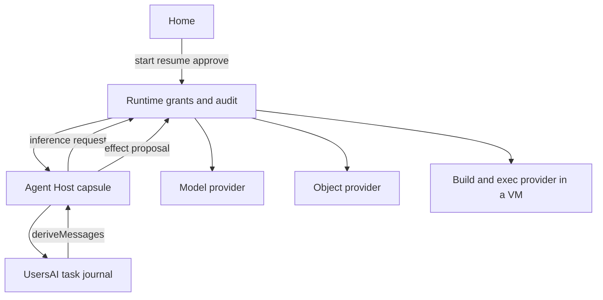
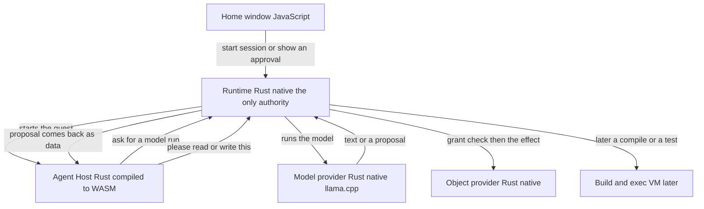

# DeepSeek Harness vs ElastOS Assistant

**Landing (your choice):** after you approve this plan, I write the audit into the task doc only. Nothing goes to GitHub or Anders until you say so. This is later-release design, not 0.8.0 work.

Research: [DeepSeek Harness core](79794966-8dd1-432d-9db7-45dab6085745) (docs + package READMEs, no clone), [ElastOS agent](bc38d7fb-7265-44a1-8660-a7b8839746b6), [capsule substrate](a1de16c0-dbbd-496d-8375-ebc6f0f96c62). I also read [docs/AGENT_ARCHITECTURE.md](docs/AGENT_ARCHITECTURE.md), [capsules/assistant/browser/agent-live.js](capsules/assistant/browser/agent-live.js), [agent-context.js](capsules/assistant/browser/agent-context.js), and the `--cache-ram 0` comment in [local_llama.rs](capsules/model-provider/src/local_llama.rs).

## Honest verdict

You are right. We have done a lot on the **agent side as a product surface and as a local-AI operator**. That is not the same pedigree as a coding harness.

DeepSeek Harness (`dsh`, MIT, developer preview) is an all-plugin Cordis runtime whose job is: explore a repo, edit files reliably, run shell/tests, keep a reconstructable session, and **hit the model prefix cache** on every later step. The model adapter, tool registry, session log, and the loop itself are plugins.

Our installed Assistant is a Home chat + Studio app. [docs/AGENT_ARCHITECTURE.md](docs/AGENT_ARCHITECTURE.md) says this in so many words: it is **not** the future Agent Host. The live prompt in [agent-live.js](capsules/assistant/browser/agent-live.js) is explicit: no tools, no capsule authority. `TEXT_CONTRACT_CAPABILITIES.tools.supported` is `false`. Each turn is one `runs_create`. That is the correct 0.8.0 boundary. It is also why it cannot code.

The future you want (a person and an agent write an app on their ElastOS computer, then later package it with Elacity dDRM and sell it) is **two products stacked**:

1. A **coding Agent Host** that can read, edit, run, and test inside granted capabilities.
2. A **create-and-admit capsule** path (project files, build, whole-closure signature, local self-trust), and only then a **catalog + rights + payment** path for other Homes.

(2) is later than (1). Selling an app is the content-capsule pattern already written for models and video, applied to an executable CID. That tree is not built.

## What each product actually is

**DeepSeek (`dsh`)**
- Node/TypeScript, Cordis “everything is a plugin”, profiles `web` / `headless` / `sdk` / `acp`.
- Append-only session log is the only model context. `deriveMessages()` is a pure fold. “Model-visible means logged.”
- One loop: turn = zero or more steps; step = one model request + its tools. Waterfalls: `agent/pre-step`, `agent/request`, `llm/stream`, `tools/pre|execute|post`.
- ~40 model-facing tools: `read`/`write`/`edit`, `glob`/`grep` (packaged ripgrep), `bash`/`pwsh`, PTY, LSP (4 queries), web search/fetch, subagents, jobs, todos, goals, skills, schedules, MCP, optional Agent Teams.
- Edit reliability: read-before-write, unique literal replace, content-addressed version CAS, stale = re-read.
- Sandbox is same-kernel (bubblewrap / Landlock / Seatbelt / Windows ACL). They say in `SAFETY.md` it is **not** a security boundary.
- Cache design is first-class: system prompt is surface node 0; capable routes **append** a new system message after cached history (`systemPromptUpdate: in-history`); volatile facts (cwd, time) are user-context snapshots; compaction never shadows node 0.

**ElastOS Assistant today**
- Web-projection capsule. Browser JS loop. Model provider is a separate native capsule.
- One text (or Studio image/video) run per turn. No tool role on the wire.
- Context: system (8k chars) + notes (4k) + 8 recent turns + up to 4 lexically retrieved older turns. Excerpting, not summarisation. Token estimate is mostly `chars/4`.
- llama.cpp is started with `--cache-ram 0` (“Admission covers the live context only, without cached prompts”). Every turn rebuilds and rehashes the full payload. Prefix cache is **off by policy**.
- What we *have* optimised, and it is real: memory admission (weights + KV + scratch + 10%/1 GiB headroom), one local engine, 60 s idle release, download resume, exact `{api}/input_tokens` refuse, hosted Inbox approval for leaving-the-box prompts, principal-owned workspace v2 (8 MiB, revision CAS), cancel/settlement_unknown, fork that cannot reattach a run.
- Those are **ops and privacy** wins. They are not a coding loop.

**Capsule substrate today** (needed for “code an app here”)
- Manifest, roles, no-WASI Wasmtime component path, `elastos init` / host `cargo` / `componentize`, `sign` (manifest + **entrypoint file only**), `publish` (CID, not a store listing).
- Every shipped UI app is a static HTML/JS tree copied into the Home. No in-Home editor, git, project volume, compiler, or hot reload.
- Third-party executable admission is still closed (#217 in the roadmap sense). Marketplace install of a new app is policy text, not a button. dDRM is a protected-**media** model, not an app-sale license.

## Side-by-side grades

The full table and bar chart are in [DeepSeek vs ElastOS grades](/Users/sash/.cursor/projects/Users-sash-Sparks/canvases/deepseek-vs-elastos-grades.canvas.tsx).

Scale: **5** = production-grade for that job; **3** = real but incomplete; **1** = sketched or prompt-only; **0** = absent. “Ours+path” is the grade if we take the mapping below and do not copy Node.

- **Multi-step agent loop** — dsh 5 / us 1 / ours+path 5. Their turn/step/inbox/cancel/retry is the thing to clone as a **Rust event machine**, not as Cordis. We have one-shot chat plus a written Agent Host contract.
- **Session log / reconstructability** — dsh 5 / us 2 / ours+path 5. They have JSONL+zstd generations, fork-at-closed-boundary, “model-visible means logged.” We have a workspace JSON of chat messages. Path: append-only task journal under `UsersAI`, same invariant.
- **Prefix / KV cache** — dsh 5 / us 1 / ours+path 4. They designed the log so a capable model keeps hitting cache. We disable llama.cpp prompt cache and reshuffle history every turn. Path: stable prefix packing + turn `--cache-ram` back on once admission can count a cached prefix. Local Qwen 1.5B will never match DeepSeek-flash’s 1M-context in-history tricks; the **algorithm** still transfers (do not rewrite byte 0).
- **Compaction / memory** — dsh 4 / us 2 / ours+path 4. They summarize a genuine prefix, never node 0, prune huge tool results first. We drop/excerpt. No summariser. Path: compaction as a logged replacement, using the same local model with `purpose: compaction`.
- **Tool system** — dsh 5 / us 0 / ours+path 5. They have a guarded pipeline (log call → policy → approval → guards → body → one result). We send no tools. Path: model output is a **proposal**; Runtime is the pipeline. This is already in AGENT_ARCHITECTURE.md. Do not give the capsule a host `bash`.
- **Filesystem + edit reliability** — dsh 4 / us 0 / ours+path 5. Their CAS + read-before-edit is the pattern. Their observation map dies on resume (weak). Path: object-provider + versioned objects; observation is durable in the journal, not a `WeakMap`.
- **Shell / tests / diagnostics** — dsh 4 / us 0 / ours+path 3 then 4. They use host bash + optional LSP. We have none. Path: a **build/exec provider** in a micro-VM (not the Browser VM, not `developer_mode` Terminal). Tests are `run` inside that grant. LSP can wait.
- **Git / undo / checkpoints** — dsh 2 / us 0 / ours+path 3. They checkpoint the **log**, not file bytes. No `/undo`. Path: object versions + journal; optional later snapshot provider. Do not pretend the chat log is undo.
- **Skills / AGENTS.md / subagents** — dsh 4 / us 0 / ours+path 3 then 4. They inject catalogs as user-context snapshots so the prefix stays stable. Path: same, as granted files, not system-prompt rewrites. Subagents = child Agent Host instances with narrowed grants (we already require per-instance binding).
- **Local-model ops** — dsh 1 / us 5 / ours+path 5. We are ahead: admission, idle release, resume, exact token refuse, one-engine, hosted-vs-local privacy labels. Keep this. dsh assumes a cloud API.
- **Hosted model + approval + secrets** — dsh 2 / us 4 / ours+path 5. Their default-on `dsh_session_log` uploads the session to the provider. We keep keys in the provider, Inbox-gate hosted Assistant creates, and treat model output as untrusted. Keep this and make tool effects use the same Inbox/mandate model.
- **Security / capability model** — dsh 2 / us 4 (today) / ours+path 5. Today we win by **having no tools**. The day we add shell-on-the-host we become them. The whole point of ElastOS is that a tool is a capability import, not a plugin in the agent process.
- **Create an app inside the computer** — dsh 3 (they can write any files on disk) / us 1 / ours+path 3 then 4. They can scaffold a repo on the host. We can `elastos init` on the operator machine. In-Home: need a Projects root on the object provider + build provider.
- **Package / admit / sell (dDRM)** — dsh 0 / us 2 / ours+path 2 then 4. They have a plugin manager. We have content publish, protected-media dDRM, and a closed third-party executable gate. App sale is later and must not be built inside Assistant.

**Overall coding-agent pedigree:** dsh **5**, us **1.5**, ours+path **4–5** (4 until a confined exec/build provider exists).

**Overall “local private computer” pedigree:** us **4**, dsh **2**. Do not trade the first for the second.

## What to copy (patterns, not code)

Copy these into **our** Agent Host. Each one maps to a Runtime/provider seam, not to a Cordis plugin.

1. **Append-only journal is the only model context.** `deriveMessages()` as a pure fold. New model-visible input requires a journal event before the request is frozen.
2. **System prompt is surface node 0**, not a side field. Empty node reserves the head. Capable routes append; incapable routes (local llama, most hosted) rewrite node 0 only when the series breaks.
3. **Volatile facts are user-context snapshots** (cwd, time, open files). They must not touch byte 0 of the prefix. This is how we can turn `--cache-ram` back on.
4. **Request series** = cache epoch. Compaction, image offload, or a tool-schema change starts a series. Resume does not.
5. **Guarded tool pipeline with a fixed order.** Log the proposal, Runtime capability check, approval/mandate, execute in the owning provider, one audited result. Missing authority fails closed.
6. **Read-before-edit + version CAS**, durable across resume. Stale = re-read. Exclusive vs parallel tool classes (writes exclusive).
7. **Unanswered tool calls get a terminal result** (`not started` / `outcome unknown` / `aborted before dispatch`). No silent retry of side effects.
8. **Compaction is a prefix-preserving replacement** that never shadows node 0. Reject a summary that does not shrink.
9. **Checkpoint the journal before any external effect.** Cancel during the flush does not enter the provider.
10. **Skills and project instructions are appended user messages**, budget-capped, not system-prompt rewrites.

## What not to copy

- Cordis plugins as the security principal (a plugin can rewrite the prompt and short-circuit `next()`).
- Same-kernel sandbox + `danger-full-access` as “enough.”
- PTC `run_code` and Creator-mode `vm` inside the agent process.
- Default-on session upload to the model vendor.
- Host `bash` / host `rg` as the execution world.
- Their observation `WeakMap` (dies on resume).
- Porting the TypeScript monorepo, Electron desktop, or pnpm plugin manager.

Anders already wrote the inversion we need in [docs/AGENT_ARCHITECTURE.md](docs/AGENT_ARCHITECTURE.md): Agent Host owns the loop; **Runtime authorizes**; model output is a proposal; UI is not a grant; harnesses are swappable.

## How we get there without becoming a Node harness



**Phase A — still not coding, but stop fighting our own cache (small, after 0.8.0).** Stable prefix packing in [agent-context.js](capsules/assistant/browser/agent-context.js) (fixed system node, append-only notes, do not reshuffle retrieved excerpts into the prefix). Measure whether local llama can then use a prompt cache. Keep `--cache-ram 0` until admission counts it. This is the only phase that might touch current Assistant without pretending it is a coder.

**Phase B — Agent Host journal + proposal loop (the pedigree step).** Rust (or a resident component) implements turn/step, inbox, cancel, retry, and an append-only journal under `UsersAI`. First tools are **read-only** object-provider windows: `read`, `glob`, `grep` over a granted project root. Hosted/local models both go through the existing model contract; add a `tools` field only when the offer and the grant exist. Inbox/mandates already specified: allow-once, session, standing.

**Phase C — write path.** `write` / `edit` as object-provider CAS. Observation durable in the journal. No host paths in the Agent Host.

**Phase D — run/test path.** A **build/exec provider** (new provider role, micro-VM, not Browser VM, not host Terminal). Agent proposes `run`; Runtime admits argv + workspace grant; only artifact bytes and logs come back. This is also the compiler: host-side or VM-side `componentize`, never rustc inside the Agent Host and never WASI on the product component ABI.

**Phase E — in-Home create.** `localhost://Users/<root>/Projects/<app>` as the workspace. Documents/Library are not enough; this is a project volume. `elastos init` becomes an in-Home scaffold that writes that tree. Signature must cover the **closure**, not only the entrypoint file (today’s `elastos sign` is not enough for a web app).

**Phase F — later, sell.** Local self-trust of the owner’s key on **their** Home. Other Homes still need #217 (signed third-party capsules, package approval, revocation). Marketplace payments and dDRM stay in providers, applied to an executable CID the way protected video is specified. Assistant must not become the store.

## Local-AI honesty

A Qwen 2.5 1.5B on device will not feel like DeepSeek-flash + `dsh`. The harness can still be excellent: short tools, strict schemas, small exclusive writes, compaction that keeps node 0, prefix cache so each `edit` is cheap, and hosted models as an explicit, approved step-up. The product story is “this computer’s agent,” not “we cloned Cursor.”

Their PTC (model writes a script that calls tools) is attractive for small local models (one `run_code` instead of 20 native tool schemas) and **dangerous** if that script runs in the Agent Host process. If we ever want it, the script runs in the exec VM and each `tools.foo()` is a new Runtime proposal.

## How we build it without leaving Anders' rules

Scope stays Anders'. This note does not start a branch. #116 and #277 stay phone layout and setup progress. A coding Agent Host is a later issue he accepts, then one concern per PR on current develop, with the usual gate before any push.

The build follows the split already in [docs/AGENT_ARCHITECTURE.md](docs/AGENT_ARCHITECTURE.md) and [PRINCIPLES.md](PRINCIPLES.md). The Agent Host owns the loop. Runtime authorizes. Providers perform effects. Home only presents sessions and approvals.

- **3 No ambient authority.** The host starts with no filesystem, network, or shell. Each tool is a granted Bus effect.
- **5 Small trusted core.** Authority stays in Runtime. The loop is a capsule. Exec and compile are a provider.
- **7 One authority model.** A human and an agent use the same grant, Inbox review, and audit path.
- **10 One canonical path.** Effects go through typed Runtime resources. No second HTTP tool API beside the Bus.
- **11 Fail closed.** No grant, no listener, or an unknown settlement stops the effect and says why. The chat must not claim it can code before that path exists.
- **12 Docs, code, tests agree.** [docs/AGENT_ARCHITECTURE.md](docs/AGENT_ARCHITECTURE.md) is the contract. A PR that implements a piece updates that doc to "installed" only for the path it proves.
- **16 UI is not authority.** Home and the Assistant page render state. They do not grant, and they do not become the loop.
- **18 Isolated capsules.** The coding host is a resource-bounded instance, not a host process.
- **19 Consequences, not transports.** A read, a write, and a process run are different classes. A retry of a write needs a durable effect id. `settlement_unknown` stays explicit.

Anders' review rules, from [AGENTS.md](AGENTS.md), apply on every PR in this line:

- One coherent concern, its own tests, and the smallest `just verify` surface that covers it.
- Gateway, grants, provider launch, confinement, and signing need a posted independent adversarial review, `VERDICT: PASS`, from a different model family, on that exact head.
- Source tests are not installed proof. The PR reports the built artifact, the installed artifact, and the live command, the same way provider changes do.
- A user-visible journey goes in the journey register. Accepted Assistant journeys (chat, cancel, Studio, model picker) stay green.
- Pre-push is `just ci-local-prepush` on current develop, one gate at a time, with the Node 26 and Python 3.12 PATH we already use.

### Tests, phase by phase

**A. Prefix packing only, still inside today's Assistant.** Node tests beside `scripts/home-agent-*.test.mjs` assert the compiled payload: system text is byte-stable across turns, notes and retrieved excerpts sit after it, and a changed note does not rewrite the head. A second test asserts `--cache-ram` stays `0` until that stability test exists. No new grant, so no security review. Do not enable the prompt cache in the same change as the packer.

**B. Journal and read-only proposals.** Pure Rust tests, no Wasmtime: `deriveMessages`, series start, compaction that refuses to shadow node 0, and a crash that writes `not started` / `outcome unknown` instead of retrying. A component fixture, same style as `elastos/tests/fixtures/components/bus-v1`, proves the guest can only call the Bus. A gateway test proves a read proposal with no grant fails closed, matching the hosted `approval_required` pattern. Recorded journals replay to the same model bytes (their snapshot idea, as `cargo test`). This PR touches grants, so it gets the adversarial review before push.

**C. Write and edit.** Object-provider tests: unread target refused, stale version refused, resume still has the observation because it is a journal event. One write is one durable effect id. Parallel writes stay exclusive.

**D. Run and build.** Confinement tests on the new provider: argv and workspace are the grant, no host path is visible to the Agent Host, the Browser VM is not the runner, and a cancelled flush never starts the process. Provider-launcher review is mandatory. Installed-provider verify runs on the CI install jobs.

**E and F. In-Home create, then sell.** Separate issues. Signature tests must hash the whole tree, not only the entrypoint. Admission of another person's capsule stays on #217. Marketplace and dDRM tests stay on those providers. Assistant tests must not grow a store.

Every phase keeps the current Assistant contract tests green: no tools on the chat path until a grant exists, cancel and `settlement_unknown` unchanged, hosted creates still stop in Inbox.

## Where Rust and WASM sit, in plain words

Rust is the language. WASM is one way we run some of that Rust so it cannot touch the machine. They are not two products.

```text
Home window          JavaScript in the browser. Chat, Studio, approval cards.
Runtime              Rust, native. The only authority. It runs the WASM engine.
Agent Host           Rust compiled to WASM. Thinks, keeps the journal, proposes effects.
Model provider       Rust, native. Runs llama.cpp or a hosted model.
Build / exec         A small VM, later. Compiler, tests, shell.
```

- **Home window.** Stays JavaScript. It draws the conversation. It does not decide, and it does not hold the coding loop.
- **Runtime.** Already Rust, already native. It checks the grant, routes the call, and writes the audit. This is the trusted core (principle 5). Wasmtime, the WASM engine, lives here.
- **Agent Host.** Rust source, compiled to a WASM component. The model can ask this code to do anything, so this code is the one we lock down. Inside WASM it has no filesystem and no network. The only thing it can do is send a typed request on the Bus. Runtime then allows or refuses it.
- **Model provider.** Rust, native, as it is today. llama.cpp needs the CPU, a lot of memory, and native libraries. The WASM guest is capped at 128 MiB and cannot see files, so the model cannot run there.
- **Build / exec.** Later, a micro-VM with a normal toolchain. Compiling an app needs cargo, a filesystem, and processes. That is a provider Runtime starts, not a second copy of the agent.



One turn, in order: the window asks Runtime to start a session. Runtime starts the WASM Agent Host. The host asks Runtime for a model run. Runtime asks the native model provider. The model may answer with text, or with a proposal such as "read this file." The host sends that proposal back through the Bus. Runtime checks the grant. Only then does an object provider or, later, the build VM do the work. The result comes back as data. The host still cannot open the file itself.

## Does the Runtime use WASM already?

Yes, in one place, and the word "wasm" on the apps you use means something else.

The docs make the other reading reasonable. Every app manifest says `"type": "wasm"`. [docs/ARCHITECTURE.md](docs/ARCHITECTURE.md) describes the Wasmtime component path as the capsule boundary. [AGENTS.md](AGENTS.md) says `setup-source-home.sh` builds first-party WASM capsules and installs their root WASM entrypoints. The script that actually runs copies each app tree and, for a web projection, deletes stray `.wasm` files beside it. `build_component_capsule` is defined in that script and never called. So the target is written down, and a running Home has not arrived there.

**What you run today is not the WASM engine.** Home, Assistant, Chat, Documents, Library, System, and the other first-party apps have `"type": "wasm"` in `capsule.json`, and `"execution": "web-projection"`. They are HTML and JavaScript in a sandboxed browser frame. Runtime checks a signed launch token before an effect. [docs/ARCHITECTURE.md](docs/ARCHITECTURE.md) says this directly: shipped first-party UI apps remain `elastos.runtime-projection/v1` web projections.

**The real WASM runner exists and is not what those apps use.** Runtime includes a Wasmtime component runner in [elastos/crates/elastos-compute/src/providers/component.rs](elastos/crates/elastos-compute/src/providers/component.rs). A guest is a WASM component (`elastos.component/v1`), with no filesystem, no sockets, a 128 MiB cap, and a fuel limit. The only guests in the tree are `examples/hello`, `templates/capsules/component-app`, and the test fixture `elastos/tests/fixtures/components/bus-v1`. No shipped app uses that ABI yet. The coding Agent Host would be the first product guest on a path that is already built and tested.

**Providers are native Rust processes.** The model provider, object provider, and the other `type: microvm` capsules run as operating-system processes. The manifest word "microvm" is a legacy label. They are not WASM, and they are not the Browser VM. The Browser VM is a separate Chromium machine for the Browser app.

```text
Today
  Apps you see     JavaScript web projections. Manifest says wasm. Wasmtime does not run them.
  Runtime          Rust. Contains the Wasmtime engine, used by the component path.
  Component guests examples/hello and a test fixture only.
  Providers        Rust processes. llama.cpp, files, wallet, and the rest.

Proposed coding agent
  Same window      JavaScript. Still not Wasmtime.
  Same Runtime     Rust. Now also starts the Agent Host guest.
  Agent Host       Rust compiled to WASM. First product use of the component runner.
  Same providers   Rust processes, plus a later build VM.
```

## What a WASM file is

A WASM file is a compiled program in a portable format. Rust is one language that can produce that file. The Runtime binary and the model provider are the same language compiled into a normal Mac or Linux program. `examples/hello` is Rust compiled into `hello.component.wasm`. Wasmtime, inside the Runtime, loads that file and runs it in a room with no files and no network.

There are three different words that keep getting mixed:

- A **crate** is a Rust library or program in source form. Thousands of crates can exist in a Rust workspace. That does not mean thousands of running programs.
- A **capsule** is a package the Runtime agrees to install: a `capsule.json` plus its files. Home, Assistant, and the model provider are capsules.
- A **WASM component** is one kind of capsule body. Its entrypoint is a `.wasm` file. The Runtime runs it. `examples/hello` is this kind. Assistant is not. Assistant's entrypoint is `browser/index.html`.

The `capsules/` tree contains no `.wasm` files. Every app you open is a web page. The manifest field `"type": "wasm"` on those apps is a label. The field that decides how it runs is `"execution"`. Assistant says `"execution": "web-projection"`. Hello says `"execution": "component"` and `"entrypoint": "hello.component.wasm"`.

## Can many WASM capsules run and talk to each other?

Many capsules can be installed. They do not call each other.

Each one asks the Runtime. The Runtime checks the grant and, when the work is real, asks a provider. A chat page does not call the model provider. A future Agent Host does not call the file provider. Both ask the Runtime, and the Runtime makes the call. That is one switchboard, which is principle 10 and principle 16. A mesh of capsules talking to each other would be a second authority system.

What that means in numbers:

- **Today.** A Home you install and use does not run a WASM guest. You can install many web apps. Each is a page. They share the Runtime. They do not share memory or call each other's functions. The WASM engine stays idle during that session. It runs only when a developer executes `examples/hello` or the component test.
- **A future with many component capsules.** The engine can start each one in its own room. A read-only tool capsule and the Agent Host would still only meet inside the Runtime, as requests and results. They would not link like plugins in one process. DeepSeek works that way. ElastOS does not.
- **A limit that is real today.** A component guest runs once (`lifecycle.run`) and stops. It is not an always-on process. Thousands of long-lived WASM programs talking all day needs the resident-component work (#181). Even then, the conversations go through the Runtime.

So the computer is one Rust Runtime, a handful of Rust provider processes, and many web pages. WASM is a prepared empty room inside the Runtime. The coding Agent Host would be the first product program we put in that room.

## Where WASM fits

WASM is the Agent Host. The compiler, llama.cpp, and the shell stay outside it.

- **Yes: the coding loop.** The journal fold, prompt assembly, and proposal parser are pure. They belong in a `product-capsule-v1` component: Wasmtime, world `elastos:bus@v1`, no WASI, no filesystem, no sockets, 128 MiB and a fixed fuel budget ([component.rs](elastos/crates/elastos-compute/src/providers/component.rs)). Every effect leaves through the Bus hostcall Runtime configured. That is principle 18, and it is the opposite of DeepSeek's in-process plugins.
- **Yes, later: a resident component.** Today's `lifecycle.run` is one-shot. A long-lived agent needs the resident WASM work already listed as #181. Until that exists, the component can still own one turn and return, with the journal in `UsersAI`, but a coding session wants a resident instance.
- **No: the current Assistant page.** [capsules/assistant](capsules/assistant) is a web projection. It stays the chat and Studio UI. Growing `read` / `edit` / `bash` inside `agent-live.js` would make the iframe the product model (principles 5 and 16) and would give the loop ambient browser reach.
- **No: llama.cpp.** Inference stays the native model provider. The component requests a run through Runtime. Prompt-cache policy stays in that provider.
- **No: rustc, Cargo, or a shell.** The component runner has no filesystem and cannot host a toolchain. Compile and test run in a future build provider (micro-VM, provider role, #182). Raising the component to WASI so a compiler fits would drop the no-ambient-authority ABI.
- **No: PTC inside the guest.** If a small local model wants one `run_code` script, that script runs in the exec VM. Each `tools.foo()` comes back out as a new Bus proposal. The guest does not get a host closure.

So the architecture is three WASM-or-not seats: a WASM Agent Host, a native model provider, and a VM build/exec provider. Home's web projection is only the window.

## Risks

- Adding host shell “to catch up” throws away the only advantage we have.
- Enabling llama prompt cache without fixing prefix stability will look like a win and be a lie (admission and reuse will disagree).
- Signing only the entrypoint lets a “published app” change the rest of the tree.
- Treating Marketplace / dDRM as an Assistant feature couples a later rights product to a chat UI.
- DeepSeek is preview and will break; copy invariants, not their package tree.

## How this side project starts

This stays off #116 and #277. It is a local spike until you choose to present it. No PR, no GitHub comment, and no Anders note before that.

- **Start from current `origin/develop`.** Not from the phone branch and not from the setup-progress branch. Those carry unrelated review. A fresh branch sees the Runtime as the team last merged it.
- **Own worktree.** `/Users/sash/code/wt-agent-host`, branch `spike/agent-host`. `spike/` matches other experiments in this repo and says "not a 0.8.0 merge." Worktrees stay under `/Users/sash/code`.
- **Stay aligned the way you guessed.** At the start of a working session, `git fetch` and merge `origin/develop` into the spike. That is the same habit as #116 and #277. Do it before writing more, so a week of Anders' PRs does not turn into a large conflict. The pre-push gate runs only when there is something to push.
- **Do not open the PR early.** A draft PR still shows up for the team. Keep the branch local. Push and open the PR when you decide the slice is ready to present. The presentation is a result with a link, a few lines, and the tests. Scope of what merges remains Anders'.
- **First slice, when we start coding.** A new component next to `examples/hello`: Rust compiled to `elastos.component/v1`, one turn, journal fold, no tools, no change to the Assistant page. That uses the WASM room a Home does not use today, and it does not change the chat people already have. Prefix packing inside the live Assistant is a later, separate product change, because it touches the shipping app.
- **While 0.8.0 reviews are moving.** The spike can sit beside them. It must not take the pre-push gate at the same time as #116 or #277, and it must not edit those branches.

## After you approve

I will write this grading, the phased path, the test gates, and the WASM seats into [ELASTOS-MOBILE-UIUX.md](/Users/sash/Sparks/.cursor/tasks/ELASTOS-MOBILE-UIUX/ELASTOS-MOBILE-UIUX.md) as an internal design note dated today. No GitHub, no Anders note, no code.
