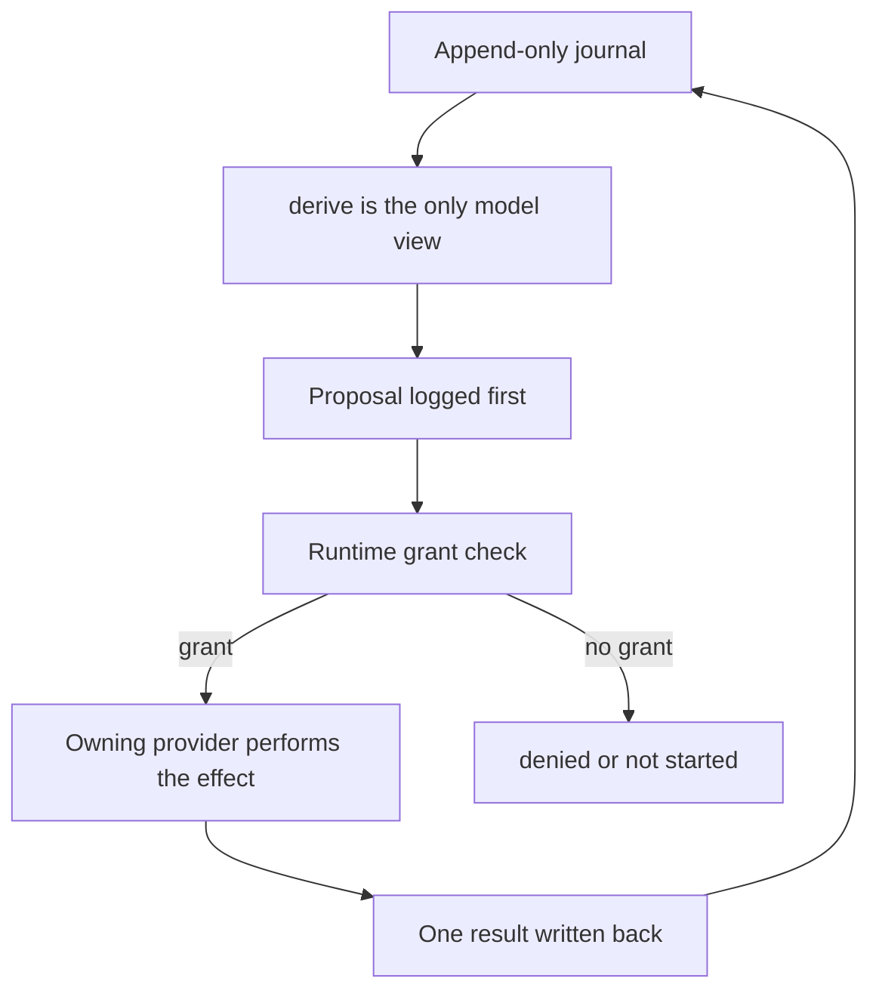
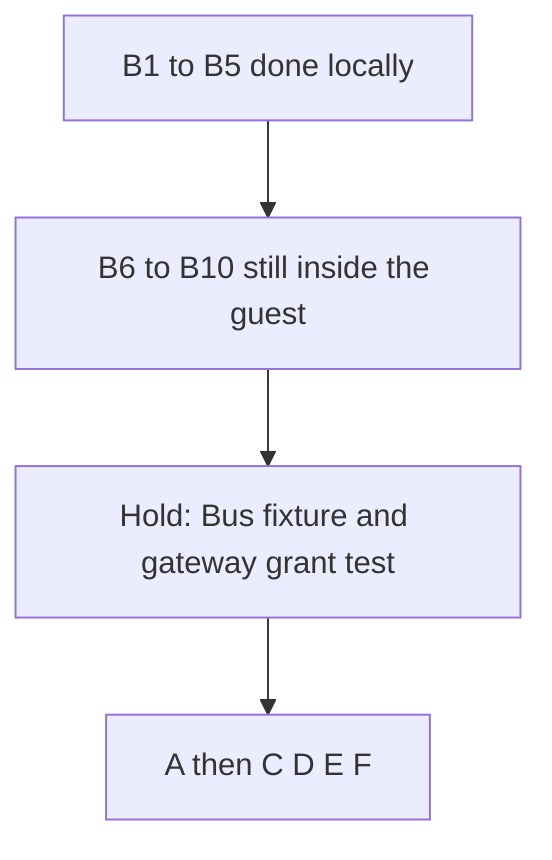

# Agent Host, grade by grade

Outcome. This file is the spec for one todo at a time. The spike stays on local branch `spike/agent-host` in `/Users/sash/code/wt-agent-host`. That branch has no upstream. Nothing here is merged to `main` or pushed. Section 7 holds the exec micro-VM card. The guest records a run and a capped result. The VM is not booted. Opening the built app from Home, and selling, stay unbuilt. Prefix packing waits until after 0.8.0. `UsersAI` and any push still wait.

This file is the working plan. The short audit stays in [deepseek_harness_audit_50b04c88.plan.md](/Users/sash/.cursor/plans/deepseek_harness_audit_50b04c88.plan.md). The scores stay on the canvas [deepseek-vs-elastos-grades.canvas.tsx](/Users/sash/.cursor/projects/Users-sash-Sparks/canvases/deepseek-vs-elastos-grades.canvas.tsx). DeepSeek quotes below are from `deepseek-ai/deepseek-harness` branch `master`, read 12 Oct 2026. They are the pattern. They are not code we paste.

Scale: 0 absent, 1 sketched, 3 real but incomplete, 5 production for that job. A+ is a 5 on every row. A path grade of 5 means the target is named. The spike has not built it yet.

Working rule: nine tenths of a slice is the invariant, the refusals, and the tests in that grade's section. The remaining tenth is a proof in [examples/agent-host/src/lib.rs](/Users/sash/code/wt-agent-host/examples/agent-host/src/lib.rs) on `spike/agent-host`. Merge `origin/develop` before a coding session. No commit, push, or PR until you ask. Do not take the pre-push gate while #116 or #277 might need it. Principles that bind every section: 3 no ambient authority, 5 small trusted core, 7 one authority model, 10 one canonical path, 11 fail closed, 16 UI is not a grant, 18 isolated capsules, 19 consequences govern effects.

## Must do on every slice

- Start in `/Users/sash/code/wt-agent-host` with `HOME=/Users/sash`. Leave `CARGO_HOME` and `RUSTUP_HOME` on the user defaults. Do not set `HOME` to the desktop test home.
- `git fetch origin` and `git merge origin/develop` before editing. If the merge is not clean, stop. Do not rewrite history to get past it.
- One slice, then stop. B6 does not include B7.
- The fixture grant string `fixture-grant` is a test token inside this example. It is not a Runtime grant, not a secret, and not copied from a Home.
- Do not call `providers.invoke`. Do not edit the WIT. Do not edit `component.rs` in this slice. Do not touch Assistant, `local_llama.rs`, the desktop Home data dir, #116, or #277.
- `cargo fmt` first, then `./verify.sh`, then `./run-local.sh`. The formatted file is the one that must pass. A wasm32 warning is still a failed slice. The wasm32 build does not include `#[cfg(test)]`, so a variant that only a test constructs still warns. Add `Cancelled` in B7, in the same change as `cancel()`, which is what constructs it.
- `run()` must return Ok. The summary role stays `System` in this slice.
- No commit, push, or PR unless you ask. No `just ci-local-prepush` on this slice.
- After the proof, one line in the task doc with the wasm SHA-256. Then stop.

## Review corrections

These corrections win when an earlier sketch in this file disagrees. The sketches stay as the reason for the grade. They are not the diff.

DeepSeek, checked against the behavior this plan already cites (`deriveMessages`, the tool pipeline, the compaction README, the observation-policy README) and against the guest that is actually on disk:

- Their log is the durable record. `deriveMessages` is a projection. Empty assistant text stays in the log and is omitted from the view. The target `model_bytes` that called `derive` mixed those two layers. Replay would then lose the stored empty node, which contradicts "stored and omitted." Correction: `model_bytes` and `replay` stay inverses of the log. `derive` is the view. Do not filter inside `model_bytes`.
- Their compaction replacement is one user message. The guest today asserts the summary role is `System`, in `run()` and in `compaction_keeps_node_zero_and_starts_a_new_series`. Changing that role inside B6 fails the Wasmtime load. The user checkpoint is a later commit, and that commit updates both assertions together.
- Their crash window is a lock left open between `compaction/start` and `compaction/end`. Setting `compaction_open` and clearing it inside one function is not a window a test can hit. Split `begin_compact` and `commit_compact`, and keep `compact_backup` on the journal.
- Their observation map dies on resume. We still refuse to copy that. The correction is only that B6 does not add the observation type yet.
- Their shell grade is host bash. We still do not copy it.
- `open_turn` returned `journal.epoch`. That is not a turn id, and the function took `&Journal`, so it could not record the turn. The later slice stores `turns` on the journal and returns the new id.
- `admit_snapshot` returned `before.is_some()`. `model_bytes` of an empty log is already `Some`, so the bool did not mean the snapshot was kept. Return false when cwd or time is empty, and true only after the append.
- `propose_restore` treated every `version <= current` as real. A version the journal never recorded must be refused. Keep a list of observed versions. The object provider remains the authority for bytes.
- `other_home_may_admit` does not belong in the guest. Admission of another person's capsule stays the Runtime policy behind #217.
- `record_visible` discarded `kind`. Do not implement that function in B6. When a later slice records a todo or a goal, the kind is part of the stored node.
- Pasting the whole target block fails `cargo clippy -- -D warnings`, because unused private functions are warnings and `verify.sh` denies warnings. Each slice adds only the functions that a test or `run()` calls.

What already agrees, and stays:

- Node 0 stays the system head. Append does not bump the epoch. A real rewrite does. A non-shrinking summary is refused.
- Crash before dispatch is `NotStarted`. Crash after dispatch is `SettlementUnknown`. Neither dispatches again.
- No `providers.invoke` in the guest. No host path. No session upload. No `run_code` in the guest.
- `--cache-ram` stays `0` until a later change also teaches admission to count the cache.
- The Assistant prompt still says there are no tools.

## B6 slice card

This is the only diff when execution is requested. One commit if a commit is requested. Do not start the later todos in the same edit.

Files:

- [examples/agent-host/src/lib.rs](/Users/sash/code/wt-agent-host/examples/agent-host/src/lib.rs)
- [examples/agent-host/README.md](/Users/sash/code/wt-agent-host/examples/agent-host/README.md)
- [examples/agent-host/capsule.json](/Users/sash/code/wt-agent-host/examples/agent-host/capsule.json) description only. Leave `wit_world_sha256` at `7a026e0a641c8c04214576dc85a677e0b52c9f02866d231119f9a3ba609d49e2`.

Do not edit the WIT, `component.rs`, Assistant, `local_llama.rs`, #116, or #277.

```rust
enum ProposalKind { Unspecified, Read }

enum StepState {
    Prepared,
    NotStarted,
    Denied,
    Cancelled,
    Dispatched,
    SettlementUnknown,
}

struct Step {
    id: u64,
    state: StepState,
    kind: ProposalKind,
    resource: String,
    grant: Option<String>,
    effect_id: u64,
}

fn propose_step(journal: &mut Journal) -> u64 {
    let id = u64::try_from(journal.steps.len()).unwrap_or(u64::MAX).saturating_add(1);
    journal.steps.push(Step {
        id,
        state: StepState::Prepared,
        kind: ProposalKind::Unspecified,
        resource: String::new(),
        grant: None,
        effect_id: id,
    });
    id
}

fn propose_read(journal: &mut Journal, resource: &str) -> u64 {
    let id = propose_step(journal);
    let step = journal.steps.iter_mut().find(|step| step.id == id).expect("just pushed");
    step.kind = ProposalKind::Read;
    step.resource = resource.to_string();
    id
}

fn authorize(journal: &mut Journal, id: u64, grant: Option<&str>) -> bool {
    let Some(step) = journal.steps.iter_mut().find(|step| step.id == id) else {
        return false;
    };
    if step.state != StepState::Prepared {
        return false;
    }
    match grant {
        None | Some("") => {
            step.state = StepState::Denied;
            step.grant = None;
            false
        }
        Some(grant_id) => {
            step.grant = Some(grant_id.to_string());
            true
        }
    }
}

fn dispatch(journal: &mut Journal, id: u64) -> bool {
    let Some(step) = journal.steps.iter_mut().find(|step| step.id == id) else {
        return false;
    };
    if step.state != StepState::Prepared || step.grant.is_none() {
        if step.state == StepState::Prepared {
            step.state = StepState::Denied;
        }
        return false;
    }
    step.state = StepState::Dispatched;
    true
}

fn note_crash(journal: &mut Journal, id: u64) -> bool {
    let Some(step) = journal.steps.iter_mut().find(|step| step.id == id) else {
        return false;
    };
    match step.state {
        StepState::Prepared | StepState::NotStarted => {
            step.state = StepState::NotStarted;
            true
        }
        StepState::Dispatched | StepState::SettlementUnknown => {
            step.state = StepState::SettlementUnknown;
            true
        }
        StepState::Denied | StepState::Cancelled => false,
    }
}
```

Same commit, or the existing proofs fail:

- `a_crash_after_dispatch_is_settlement_unknown` and the guest `run()` path that dispatches `sent` must call `authorize(id, Some("fixture-grant"))` before `dispatch`. The fixture string is a test grant, not a Runtime mint, and it never leaves this example.
- `a_crash_before_dispatch_stays_not_started` stays a crash from `Prepared` with no authorize. `dispatch` then returns false and the state becomes `Denied` only if something calls `dispatch`. The test calls `note_crash` first, so the state is `NotStarted` and `dispatch` returns false without rewriting it as `Denied`.
- Do not change `compact`. The summary role stays `System` until the later checkpoint slice.
- `run()` gains one more check: `propose_read` of `localhost://Users/self/Documents/note.txt`, `authorize` with `None`, state `Denied`, `dispatch` false, epoch still 2, and `model_bytes` unchanged. Then the existing crash checks run.
- README and the capsule description say a read without a grant is denied, and that the guest still has no tool body and no Home icon. The description no longer says "One-turn".

Tests to add, and no others:

- `a_read_with_no_grant_is_denied`
- `a_second_authorize_stays_denied`
- `a_read_proposal_does_not_change_model_bytes`

Stray check before saying the slice is done. From the example directory, all of these are empty:

- `rg "providers::invoke" src`
- `rg "std::fs|std::process|std::net" src`
- a diff of `elastos/wit/elastos-bus-v1.wit`

## CI fence

The example is its own Cargo workspace, on purpose, same as `examples/hello`. `just ci-local-prepush` does not select it. The Wasmtime test in `component.rs` is `#[ignore]`, so GitHub CI does not run it either. Passing the gate is not proof that this guest ran. `./verify.sh` and `./run-local.sh` are the proof. Do not move the example into the main workspace to make the gate see it. That would widen every Runtime check.

Local proof, and nothing heavier:

```bash
export HOME=/Users/sash
cd /Users/sash/code/wt-agent-host
git fetch origin
git merge origin/develop
cd examples/agent-host
cargo fmt --manifest-path Cargo.toml
./verify.sh
./run-local.sh
```

`verify.sh` runs `cargo fmt --check`, `cargo test --locked`, `cargo clippy --locked --all-targets -- -D warnings`, then `scripts/build-component-capsule.sh`. Format first. A rustfmt diff fails the script before the tests. Fix the warning even when it is only on wasm32. `run-local.sh` loads the wasm with the ignored test and expects `lifecycle.run` to return Ok. A `BusError` from `run()` is a failed slice. Do not add `--exact` to that filter. Do not point it at `~/Library/Application Support/elastos`.

Do not run `just ci-local-prepush` for this slice. The lease is shared with #116 and #277. One gate at a time, and only when a push has been requested.

When a later push is requested, the candidate is one concern, the branch is `spike/agent-host`, and upstream stays unset until that request. Show these against `origin/develop` before the gate:

```bash
git log --oneline origin/develop..HEAD
git diff --stat origin/develop...HEAD
git rev-list --left-right --count origin/develop...HEAD
```

Then one gate, from the worktree, with `HOME=/Users/sash`, `RUST_TEST_THREADS=4`, and `caffeinate -i`. Prepend the CI Node 26 and Python 3.12 paths if the gate checks them. Merge `origin/develop` first. The gate refuses a moved base. B6 does not need the adversarial review: it does not change gateway, auth, launchers, confinement, signing, or install. The hold line does. That review is `Independent adversarial review ... VERDICT: PASS` from another model family, on that exact head, before any push of the gateway test. A PASS does not carry across a later merge unless the reviewed commit is an ancestor and the reviewed paths did not lose a change.

After the gate, still paste the `verify.sh` and `run-local.sh` results. Say in the review note that GitHub CI skips this example. Principle 12: do not claim the gate proved the guest.



## Shared shape we are building toward

Outcome. One journal, one derive, one proposal, one Runtime grant check, one provider effect, one result. No grant ends as `denied` or `not started`. Home only shows that state.

DeepSeek's loop, from [docs/subsystems/core.md](https://github.com/deepseek-ai/deepseek-harness/blob/master/docs/subsystems/core.md): claim a prompt, open a turn on the session log, derive history from that log, stream the model, dispatch tool calls through the registry, append every model-visible fact before the next step derives again.

Our seats stay split. The guest owns the log and the proposal. Runtime owns the grant. A provider owns the effect. Home only shows state.

```rust
// Goal, not yet the whole spike. Today Role is only System and User.
enum Role { System, User, Assistant, ToolResult }

enum NodeSource { Head, InHistory, Person, Snapshot, Skill, CompactionCheckpoint }

struct SurfaceNode { role: Role, text: String, source: NodeSource }

enum StepState { Prepared, NotStarted, Denied, Cancelled, Dispatched, SettlementUnknown }

enum ProposalKind { Read, Glob, Grep, Write, Edit, Run }

struct Step {
    id: u64,
    state: StepState,
    kind: ProposalKind,
    resource: String,
    grant: Option<String>,
    effect_id: u64,
}
```

The Bus call, already the product ABI in [elastos-bus-v1.wit](/Users/sash/code/wt-agent-host/elastos/wit/elastos-bus-v1.wit), is the only effect door:

```wit
record invoke-request {
  resource: resource-uri,
  operation: operation,
  body: bytes,
  grant: option<grant-id>,
}
invoke: func(request: invoke-request) -> result<invoke-response, bus-error>;
```

`bus-error.denied` is the no-grant result. The guest records that word. It does not invent a second HTTP tool API.

What is already proved in the spike, uncommitted: two turns keep node 0 byte-stable; append stays on series 1; a real head rewrite starts series 2; compaction refuses a summary that does not shrink; crash before dispatch is `not started`; crash after dispatch is `settlement_unknown`; visible bytes replay. The guest calls `runtime.info` and `identity.context` only.

## Canvas check

Source: [deepseek-vs-elastos-grades.canvas.tsx](/Users/sash/.cursor/projects/Users-sash-Sparks/canvases/deepseek-vs-elastos-grades.canvas.tsx). Scale tops at 5. Path is the named target. A+ is 5 on every row. Copying DeepSeek's shell grade of 4 would mean host bash and would drop the capability row.

- Agent loop. DeepSeek 5, today 1, path 5, A+ 5. Outcome: a turn of steps, cancel, and crash words, with model bytes unchanged by the markers. Section 1.
- Session log. 5 / 2 / 5 / 5. Outcome: `derive` is the only model view, and `replay` returns those bytes. Section 2.
- Prefix cache. 5 / 1 / 4 / 5. Outcome: node 0 stays put. The cache stays off until a measured hit. Section 3.
- Compaction. 4 / 2 / 4 / 5. Outcome: a shrinking user checkpoint, node 0 untouched, crash mid-summary is not finished. Section 4.
- Tool system. 5 / 0 / 5 / 5. Outcome: a proposal with no grant is `denied`, and `providers.invoke` is not called. Section 5.
- Edit reliability. 4 / 0 / 5 / 5. Outcome: unread and stale edits create no step, and the observation survives `replay`. Section 6.
- Shell and tests. 4 / 0 / 4 / 5. Outcome: a run proposal only. The process, when it exists, is the micro-VM. Section 7.
- Git and undo. 2 / 0 / 3 / 5. Outcome: restore proposes an older observed version and does not apply it. Section 8.
- Skills. 4 / 0 / 4 / 5. Outcome: skill text appends under 4000 bytes. A child grant is narrower. Section 9.
- Local model ops. 1 / 5 / 5 / 5. Outcome: admission, one engine, idle release, and the exact token refuse stay as they are. Section 10.
- Hosted and secrets. 2 / 4 / 5 / 5. Outcome: no key in the journal, missing approval is `denied`, no default upload. Section 11.
- Capability model. 2 / 4 / 5 / 5. Outcome: Bus-only guest, gateway deny, adversarial pass, Assistant still says there are no tools. Section 12.
- Create an app. 3 / 1 / 4 / 5. Outcome: the project resource is `localhost://Users/<root>/Projects/<name>`, and the built app opens again. Section 13.
- Package and sell. 0 / 2 / 4 / 5. Outcome: the owner's Home can trust the owner's app. Another Home stays closed until #217. Section 14.

Private-computer grades stay on the canvas and are not a fifteenth coding row: DeepSeek 2, ElastOS 4. The path must not trade that 4 away to buy a coding 5.

## Principles and Runtime check

Sources: [PRINCIPLES.md](/Users/sash/code/wt-agent-host/PRINCIPLES.md) and [AGENT_ARCHITECTURE.md](/Users/sash/code/wt-agent-host/docs/AGENT_ARCHITECTURE.md). Anders' architecture is a contract, not a claim the agent product exists. The request flow there is the Runtime need every section has to meet: Home asks Runtime to start a session, Runtime binds principal and capsule, the model proposes, the guest submits, Runtime checks resource, action, principal, session, grant, expiry, and revocation, Inbox presents consent, the provider performs, the audit path is the human one.

Non-negotiable boundaries, and the slice that would break them:

- A model response is a proposal, not permission. Broken if `authorize` treats model text as a grant. Sections 5 and 12.
- A harness is not the security boundary. Broken if the guest calls the filesystem, a shell, or `providers.invoke` with a grant it minted. Sections 5, 7, and 12.
- A visible approval card is not the grant. Broken if Home sets `StepState::Dispatched`. Sections 8, 11, and 12.
- A provider implements the operation. Runtime authorizes the caller. Broken if the object provider writes because the guest asked. Sections 6 and 7.
- One enforcing path. Broken by a second tool HTTP API beside `invoke-request`. Shared shape above.
- A capsule signature admits code. It does not authorize a user-scoped effect. Section 14.
- Human and agent effects use the same resources. `Users/` and `UsersAI/` stay parallel. Section 12's durable journal.

Principle by principle, and the outcome that keeps it:

- 1 Local first. Project files are `localhost://...` objects. Outcome: section 13 stores that resource string, never a host path.
- 2 Stable identity. A version is an immutable object. A head points at one. Outcome: section 8 restores a version, it does not overwrite history in place.
- 3 No ambient authority. Outcome: missing grant is `Denied`. The guest imports only `runtime`, `identity`, `capabilities`, and `providers`.
- 4 Carrier is not the capsule contract. Outcome: the guest names a resource and an operation. It does not open a socket, pick a peer, or call Kubo.
- 5 Small trusted core. Outcome: the fold stays in the capsule. Grant checks stay in Runtime. llama.cpp and the micro-VM stay providers.
- 6 User, operator, developer. Outcome: `elastos init` on an operator machine is not the product. The product is the in-Home project. Debug fuel and ABI strings stay out of Home copy.
- 7 One authority model. Outcome: allow once, session, and standing are the same Inbox words for a person and for the agent. Section 11.
- 8 WebSpaces. Outcome: a moniker is not a grant. The guest does not walk a WebSpace as if it were a folder it already owns.
- 9 HTTP is edge. Outcome: the gateway test in section 12 is an edge proof. The journal's identity is not the HTTP URL.
- 10 One canonical path. Outcome: undo is a granted write of an old version through the object provider. There is no guest git binary and no second undo API.
- 11 Fail closed. Outcome: empty skill, empty snapshot, non-shrinking summary, unread edit, and missing grant all leave the journal unchanged or record `Denied`. None of them succeed quietly.
- 12 Docs, code, tests agree. Outcome: each todo names the test. The plan function and the guest function use the same names. Drift is a failed slice.
- 13 Objects, capsules, spaces stay distinct. Outcome: the Agent Host capsule is not the person's project, not the Profile, and not the Store. Section 14 does not put a shop in Assistant.
- 14 Public names. Outcome: Home says Apps, Inbox, and the project name. Grant ids and epoch numbers stay in the audit, not in the button label.
- 15 Trust travels with signed content. Outcome: phase E signs the whole tree. A CID is the content. A Store row is not the identity.
- 16 UI is not authority. Outcome: Home may show `Denied` and the version list. It does not mint `grant-id`.
- 17 Design tokens. Outcome: when Home later shows step state, it uses the shared token roles. No one-off agent palette in this spike.
- 18 Isolated capsules. Outcome: 128 MiB, fuel limit, no WASI. A child is a second instance. PTC, if it ever exists, is the exec VM.
- 19 Consequences govern effects. Outcome: dispatch, execution, and observed result are separate. Uncertainty after dispatch stays `SettlementUnknown`. Retry uses `effect_id`. A payment proof does not become permission to write.

Decision rule, when two designs both compile: keep the rooted name, drop the ambient path, keep one route, leave the trusted core smaller, and use the word a person already has.

Runtime task words from the architecture, mapped onto the guest step so the two stories do not fork:

```rust
// Runtime task: created, running, waiting_for_approval, completed,
// failed, cancelled, interrupted, resumable.
// Guest step, which is not that task:
// Prepared           -> waiting_for_approval, or running before dispatch
// Denied             -> failed, fail closed
// Cancelled          -> cancelled, before dispatch
// NotStarted         -> interrupted, nothing was sent
// Dispatched         -> running, provider has the effect_id
// SettlementUnknown  -> interrupted, not resumable as a second dispatch
```

A UI disconnect does not cancel a step. Reconnecting presentation reads the journal. It does not call `dispatch` again.

## Target Rust, by canvas row

Illustration of the later slices. The B6 slice card is the only code to type next. Where a function below disagrees with that card or with the review corrections, the correction wins. Do not paste this whole block into the guest. Unused functions fail Clippy.

This extends `admit_system`, `admit_user`, `compact`, `propose_step`, `dispatch`, `note_crash`, `model_bytes`, and `replay`. Nothing here calls `providers.invoke`.

```rust
// Today Role is System | User. model_bytes uses 1 and 2.
// Target adds the tags replay must accept, and reject anything else.
enum Role { System, User, Assistant, ToolResult }
enum NodeSource { Head, InHistory, Person, Snapshot, Skill, CompactionCheckpoint }

struct SurfaceNode {
    role: Role,
    text: String,
    source: NodeSource,
}

enum ProposalKind { Read, Glob, Grep, Write, Edit, Run, Hosted }

enum StepState {
    Prepared,
    NotStarted,
    Denied,
    Cancelled,
    Dispatched,
    SettlementUnknown,
}

struct Step {
    id: u64,
    state: StepState,
    kind: ProposalKind,
    resource: String,
    grant: Option<String>,
    effect_id: u64,
}

struct Observation {
    resource: String,
    version: u64,
    text_hash: [u8; 32],
}

struct Turn { id: u64, steps: Vec<u64> }

struct Journal {
    events: Vec<SurfaceNode>,
    epoch: u64,
    steps: Vec<Step>,
    turns: Vec<Turn>,
    observations: Vec<Observation>,
    compaction_open: bool,
    compact_backup: Option<(Vec<SurfaceNode>, u64)>,
    compact_pending: Option<Vec<SurfaceNode>>,
}
```

Section 1 outcome code. A turn is a list of step ids. Markers are not model text.

```rust
struct Turn { id: u64, steps: Vec<u64> }

fn open_turn(journal: &mut Journal) -> u64 {
    let id = u64::try_from(journal.turns.len()).unwrap_or(u64::MAX).saturating_add(1);
    journal.turns.push(Turn { id, steps: Vec::new() });
    id
}

fn open_step(journal: &mut Journal, kind: ProposalKind, resource: &str) -> u64 {
    let id = propose_step(journal);
    let step = journal.steps.iter_mut().find(|step| step.id == id).expect("just pushed");
    step.kind = kind;
    step.resource = resource.to_string();
    step.grant = None;
    step.effect_id = id;
    id
}

fn derive(events: &[SurfaceNode]) -> Vec<SurfaceNode> {
    events.iter().filter(|node| match node.role {
        Role::Assistant if node.text.is_empty() => false,
        _ => true,
    }).cloned().collect()
}
```

Section 2 outcome code. Canonical bytes gain two role tags. Epoch and steps stay out. A short buffer still returns `None`.

```rust
fn role_tag(role: Role) -> u8 {
    match role {
        Role::System => 1,
        Role::User => 2,
        Role::Assistant => 3,
        Role::ToolResult => 4,
    }
}

fn model_bytes(events: &[SurfaceNode]) -> Option<Vec<u8>> {
    // Log encoding. Does not call derive. Replay of these bytes restores
    // empty assistant nodes. The model view is derive, which omits them.
    let mut out = Vec::new();
    for event in events {
        out.push(role_tag(event.role));
        let len = u32::try_from(event.text.len()).ok()?;
        out.extend_from_slice(&len.to_le_bytes());
        out.extend_from_slice(event.text.as_bytes());
    }
    Some(out)
}

fn record_tool_result(journal: &mut Journal, step_id: u64, text: &str) -> bool {
    // Only after the provider returned. One result. Empty text is stored and
    // then omitted by derive, the same way an empty assistant message is.
    let Some(step) = journal.steps.iter().find(|step| step.id == step_id) else {
        return false;
    };
    if step.state != StepState::Dispatched {
        return false;
    }
    journal.events.push(SurfaceNode {
        role: Role::ToolResult,
        text: text.to_string(),
        source: NodeSource::Person,
    });
    true
}
```

Section 3 outcome code. Volatile facts append. They do not touch node 0.

```rust
fn admit_snapshot(journal: &mut Journal, cwd: &str, time: &str, open_files: &str) -> bool {
    if cwd.is_empty() || time.is_empty() {
        return false;
    }
    let head = journal.events.first().map(|node| node.text.clone());
    let epoch = journal.epoch;
    for text in [cwd, time, open_files] {
        if text.is_empty() {
            continue;
        }
        journal.events.push(SurfaceNode {
            role: Role::User,
            text: text.to_string(),
            source: NodeSource::Snapshot,
        });
    }
    journal.epoch == epoch && journal.events.first().map(|node| node.text.clone()) == head
}
```

Phase A, later, is not this guest. The packer in `agent-context.js` must keep the same order: fixed system text, then notes, then excerpts. A changed note is a later node. `--cache-ram` stays `"0"` in that commit. The A+ measurement is a separate commit that refuses to start the engine unless admission includes the cached prefix size.

Section 4 outcome code. Today's `compact` pushes a second `System` node. The target pushes one `User` checkpoint and brackets it.

```rust
fn compact(journal: &mut Journal, summary: &str) -> bool {
    if summary.is_empty() || journal.events.len() < 3 || journal.compaction_open {
        return false;
    }
    let Some(head) = journal.events.first().cloned() else { return false };
    if head.role != Role::System || head.source != NodeSource::Head {
        return false;
    }
    let kept: Vec<SurfaceNode> = journal.events.iter().cloned().filter(|node| {
        node.source != NodeSource::Skill
    }).collect();
    let replacement = vec![
        head,
        SurfaceNode {
            role: Role::User,
            text: summary.to_string(),
            source: NodeSource::CompactionCheckpoint,
        },
    ];
    if visible_bytes(&replacement) >= visible_bytes(&kept) {
        return false;
    }
    journal.compact_backup = Some((journal.events.clone(), journal.epoch));
    journal.compact_pending = Some(replacement);
    journal.compaction_open = true;
    true
}

fn commit_compact(journal: &mut Journal) -> bool {
    if !journal.compaction_open {
        return false;
    }
    let Some(replacement) = journal.compact_pending.take() else {
        return false;
    }
    journal.events = replacement;
    journal.compaction_open = false;
    journal.compact_backup = None;
    bump_epoch(journal);
    true
}

fn note_crash_during_compact(journal: &mut Journal) {
    journal.compact_pending = None;
    if let Some((saved, saved_epoch)) = journal.compact_backup.take() {
        journal.events = saved;
        journal.epoch = saved_epoch;
        journal.compaction_open = false;
    }
}
```

Section 5 outcome code. Same grant rule as the B6 slice card. Type the card, not a second copy of these functions.

```rust
fn propose_read(journal: &mut Journal, resource: &str) -> u64 {
    open_step(journal, ProposalKind::Read, resource)
}

fn authorize(journal: &mut Journal, id: u64, grant: Option<&str>) -> bool {
    let Some(step) = journal.steps.iter_mut().find(|step| step.id == id) else {
        return false;
    };
    if step.state != StepState::Prepared {
        return false;
    }
    match grant {
        None | Some("") => {
            step.state = StepState::Denied;
            step.grant = None;
            false
        }
        Some(grant_id) => {
            step.grant = Some(grant_id.to_string());
            true
        }
    }
}

fn dispatch(journal: &mut Journal, id: u64) -> bool {
    let Some(step) = journal.steps.iter_mut().find(|step| step.id == id) else {
        return false;
    };
    if step.state != StepState::Prepared || step.grant.is_none() {
        if step.state == StepState::Prepared {
            step.state = StepState::Denied;
        }
        return false;
    }
    step.state = StepState::Dispatched;
    true
}
```

The host side, only after you say present, is the WIT call already in the world. The guest records `bus-error.denied` as `StepState::Denied`. It does not map deny onto an empty tool result.

```rust
// providers::invoke(InvokeRequest { resource, operation: "read", body, grant: Some(id) })
// Ok(response) -> record_tool_result
// Err(BusError::Denied(_)) -> StepState::Denied
// Err after the call left the guest -> SettlementUnknown, do not invoke again
```

Section 6 outcome code. The observation is a journal row. Resume is `replay` plus this vec, not a process map.

```rust
fn observe(journal: &mut Journal, resource: &str, version: u64, text_hash: [u8; 32]) {
    if let Some(row) = journal.observations.iter_mut().find(|row| row.resource == resource) {
        row.version = version;
        row.text_hash = text_hash;
    } else {
        journal.observations.push(Observation { resource: resource.to_string(), version, text_hash });
    }
}

fn propose_edit(
    journal: &mut Journal,
    resource: &str,
    old: &str,
    seen: Option<u64>,
) -> Result<u64, &'static str> {
    let Some(row) = journal.observations.iter().find(|row| row.resource == resource) else {
        return Err("not observed");
    };
    if seen != Some(row.version) {
        return Err("stale");
    }
    if old.is_empty() {
        return Err("empty");
    }
    Ok(open_step(journal, ProposalKind::Edit, resource))
}
```

Section 7 outcome code. Cancel, then the run proposal. The argv stays data.

```rust
fn cancel(journal: &mut Journal, id: u64) -> bool {
    let Some(step) = journal.steps.iter_mut().find(|step| step.id == id) else {
        return false;
    };
    match step.state {
        StepState::Prepared => {
            step.state = StepState::Cancelled;
            true
        }
        StepState::Dispatched | StepState::SettlementUnknown => false,
        StepState::Denied | StepState::Cancelled | StepState::NotStarted => false,
    }
}

fn propose_run(journal: &mut Journal, resource: &str) -> u64 {
    // resource is localhost://Users/<root>/Projects/<app>
    // argv is not a host path and is not executed here
    open_step(journal, ProposalKind::Run, resource)
}

fn checkpoint(journal: &Journal) -> Option<Vec<u8>> {
    model_bytes(&journal.events)
}
```

Section 8 outcome code. Restore is a write proposal of bytes already observed.

```rust
fn propose_restore(journal: &mut Journal, resource: &str, version: u64) -> Result<u64, &'static str> {
    let seen = journal.observations.iter().any(|row| {
        row.resource == resource && row.version == version
    });
    if !seen {
        return Err("unknown");
    }
    Ok(open_step(journal, ProposalKind::Write, resource))
}
```

Section 9 outcome code. Budget first. Child grant is a Runtime fact, recorded here only as a note the parent can see.

```rust
const SKILL_BUDGET: usize = 4_000;

fn admit_skill(journal: &mut Journal, text: &str) -> bool {
    if text.is_empty() || text.len() > SKILL_BUDGET {
        return false;
    }
    let epoch = journal.epoch;
    let head = journal.events.first().map(|node| node.text.clone());
    journal.events.push(SurfaceNode {
        role: Role::User,
        text: text.to_string(),
        source: NodeSource::Skill,
    });
    journal.epoch == epoch && journal.events.first().map(|node| node.text.clone()) == head
}
```

Section 10 outcome. No new guest function. The regression is the existing provider flag:

```rust
// capsules/model-provider/src/local_llama.rs
// "--cache-ram", "0"
// A slice that changes 0 fails unless admission's token budget includes the cache.
```

Section 11 outcome code. The hosted step carries the model resource and no key.

```rust
fn propose_hosted_step(journal: &mut Journal, model_resource: &str) -> u64 {
    // model_resource is a Runtime resource name.
    // The node text must not contain a provider key, an env value, or a .env path.
    open_step(journal, ProposalKind::Hosted, model_resource)
}
```

Section 12 outcome. The world already imports only these four. The fixture asserts that list and nothing else.

```wit
world product-capsule-v1 {
  import runtime;
  import identity;
  import capabilities;
  import providers;
  export lifecycle;
}
```

Section 13 outcome code.

```rust
fn project_resource(root: &str, name: &str) -> String {
    format!("localhost://Users/{root}/Projects/{name}")
}

fn propose_init(journal: &mut Journal, root: &str, name: &str) -> u64 {
    let resource = project_resource(root, name);
    debug_assert!(!resource.starts_with('/'));
    open_step(journal, ProposalKind::Write, &resource)
}
```

Section 14 outcome. No guest function sells anything. While #217 is closed, Runtime refuses another person's capsule. The owner's key on the owner's Home is a separate local decision. Do not add `other_home_may_admit` to this example.

Tests that close each outcome, named so section 12's "docs and tests agree" rule has a list:

- `opening_a_turn_does_not_change_model_bytes`
- `an_empty_assistant_node_is_omitted_from_derive`
- `replay_rejects_an_unknown_role_tag`
- `a_snapshot_does_not_bump_the_epoch`
- `compaction_summary_is_a_user_checkpoint`
- `a_crash_during_compaction_restores_the_saved_bytes`
- `a_read_with_no_grant_is_denied`
- `a_second_authorize_stays_denied`
- `an_unread_edit_creates_no_step`
- `cancel_before_dispatch_never_dispatches`
- `cancel_after_dispatch_is_not_success`
- `an_over_budget_skill_leaves_the_journal_unchanged`
- `a_hosted_proposal_has_no_secret_field`
- `a_project_resource_is_not_a_host_path`

## 1. Multi-step agent loop

Outcome. A turn can hold more than one step. Opening the turn and the steps does not change model bytes or the epoch. Cancel before dispatch never runs. Cancel after dispatch is not rewritten as success. Crash words stay `not started` and `settlement_unknown`.

Grades: DeepSeek 5, ElastOS today 1, path 5, A+ 5.

What it means. A turn is zero or more steps. A step is one model request plus the tool results that request produced. The person can stop a step before it runs. A crashed step is a recorded ending, not a silent second run.

Why it is valuable. One-shot chat cannot code. Coding is a chain of reads, edits, and checks, and each link has to be inspectable and stoppable.

Why we do it this way. Principle 7: a person and an agent share Inbox, cancel, and audit. Principle 16: the Assistant page does not become the loop. Today the page is one `runs_create` and the default prompt in [agent-live.js](/Users/sash/code/wt-agent-host/capsules/assistant/browser/agent-live.js) says there are no tools.

DeepSeek. The driver lives in `agent-loop`. Structural events `turn/start`, `turn/end`, `step/start`, `step/end` are logged and are not model messages. `deriveMessages` skips them. From [packages/core/session/src/index.ts](https://github.com/deepseek-ai/deepseek-harness/blob/master/packages/core/session/src/index.ts):

```ts
deriveMessages(): Message[] {
  const surface = this.surface
  const generation = surface.replaceGeneration
  if (generation !== this.derivedGeneration) {
    this.derived = []
    this.derivedNodes = 0
    this.derivedGeneration = generation
  }
  for (const seq of nodes.slice(this.derivedNodes)) {
    const msg = this.deriveEventMessage(this.log[seq]!)
    if (msg) this.derived.push(msg)
  }
  this.derivedNodes = nodes.length
  return [...this.derived]
}
```

A surface rewrite rebuilds the projection. Later appends project only the new nodes. The returned array is a fresh copy of frozen messages, so a caller cannot mutate the log by editing the view.

Our goal.

```rust
fn open_turn(journal: &mut Journal) -> u64 { /* returns the new turn id; epoch unchanged */ }
fn open_step(journal: &mut Journal, turn: u64) -> u64 { /* Prepared, no model call */ }
fn derive(events: &[SurfaceNode]) -> Vec<SurfaceNode> { /* structural events omitted; log bytes stay complete */ }
```

Tests. Opening a turn and a step does not change `model_bytes`. Two steps in one turn share the epoch. `derive` omits the turn and step markers. Slice: the loop records are the frame around B6 to B9. A real model call is not part of this slice.

Do not copy. Cordis waterfalls as the security principal. A plugin that can rewrite the prompt and skip `next()` is ambient authority.

## 2. Session log

Outcome. `derive` is the only model view. Empty assistant text stays in the log and in `replay`, and `derive` omits it. A tool result is included in the view. A step with no result is omitted from the view and remains in the log. `model_bytes` does not call `derive`. Epoch and steps stay outside the bytes. Durable storage is a Runtime `UsersAI` resource, later, not a path in the guest.

Grades: DeepSeek 5, ElastOS today 2, path 5, A+ 5.

What it means. The log is the only model context. If it was not logged, the model does not see it. Replaying the log produces the same bytes.

Why it is valuable. Resume, audit, and the prefix cache all need one history. A side JSON of chat messages drifts from what the model was shown.

Why we do it this way. Principle 10: one canonical path. Principle 12: the fold in tests is the fold in the guest.

DeepSeek. [docs/subsystems/session.md](https://github.com/deepseek-ai/deepseek-harness/blob/master/docs/subsystems/session.md): `user/message`, `assistant/message`, and `tool/result` become messages. `assistant/chunk` is skipped because the assembled message is authoritative. An empty `assistant/message` is kept for usage and skipped in the transcript. `turn/*` and `step/*` do not project. Header events do not add a second copy of the prefix. Persistence is JSONL or SQLite, with `session/flush` as the checkpoint. Fork is at a closed boundary.

Today. Assistant workspace JSON, 8 recent turns, up to 4 lexical excerpts. The spike journal is in memory only. `derive` currently clones the event vec. `model_bytes` plus `replay` already round-trip System and User text. Steps are outside those bytes on purpose, until a result is model-visible.

Our goal. A result becomes a `ToolResult` node before the next `derive`. Structural steps stay off the model bytes. Durable storage is a Runtime resource under `UsersAI`, written by the host, not a path string inside the guest. That durability waits for the present line.

```rust
fn derive(events: &[SurfaceNode]) -> Vec<SurfaceNode> {
    events.iter().filter(|node| match node.role {
        Role::Assistant if node.text.is_empty() => false,
        _ => true,
    }).cloned().collect()
}
```

Tests already present: `a_recorded_journal_replays_to_the_same_bytes`. Still to add: an empty assistant node is stored and omitted from `derive`; a tool result is included; a step with no result is omitted.

## 3. Prefix and KV cache

Outcome. Node 0 stays byte-stable across turns. Cwd, time, and open files append as user snapshots and do not start a series. Phase A packs the shipping Assistant the same way and leaves `--cache-ram` at 0. A+ is a later measured cache hit whose admission counts the cached prefix. A small local model may stay a 4.

Grades: DeepSeek 5, ElastOS today 1, path 4, A+ 5.

What it means. Byte 0 of the prompt stays stable across turns, so the model server can reuse the cached prefix. Facts that change every step are appended after that prefix. A new series is the moment the cache is allowed to miss.

Why it is valuable. Each later edit is cheap only if the prefix is reused. Turning the cache on while the prefix still changes would bill a hit and serve a miss.

Why we do it this way. The local engine is started with the cache forced off until admission can count a cached prefix. From [local_llama.rs](/Users/sash/code/wt-agent-host/capsules/model-provider/src/local_llama.rs):

```rust
// Admission covers the live context only, without cached prompts.
"--cache-ram", "0",
```

DeepSeek. `SystemPromptProjection.project` in `packages/core/agent-loop/src/runtime-context.ts`. The only accepted `systemPromptUpdate` value is `'in-history'`. Absence means rewrite message 0. `deepseek-flash` declares in-history. Other routes rewrite node 0. `startsSeries` is true when the step says so, when a surface replace landed (compaction), or when the tool schema changed on a route that cannot append tools. A provider swap alone does not start a series on a capable route: the new prompt is appended, because the route change already missed the cache. Their note: a prompt that changes most steps should be a user-context snapshot, not a system rewrite.

Our spike already does the incapable and capable cases as `admit_system(..., in_history)`.

```rust
// in_history true: push a later system node, epoch unchanged
// in_history false and text differs: rewrite node 0, epoch += 1
// same text, rewrite path: epoch unchanged
```

Path to 4. Phase A, after 0.8.0, in [agent-context.js](/Users/sash/code/wt-agent-host/capsules/assistant/browser/agent-context.js): fixed system node, then notes, then excerpts. A changed note must not rewrite the head. `--cache-ram` stays `0` in that change.

A+ to 5. A later change measures a real prefix hit and admission counts those cached tokens. A small local model may remain a 4. A capable hosted route is the 5. Do not enable the cache in the same change as the packer.

Tests. Already: `the_same_head_text_does_not_start_a_new_series`, `an_incapable_prompt_rewrites_the_head_and_starts_a_series`. Phase A Node tests: head bytes stable, notes sit after the head.

## 4. Compaction and memory

Outcome. A summary that does not shrink is refused. The surviving summary is one user checkpoint, not a second system head. Node 0 is unchanged. A crash between start and end restores the pre-compact bytes and epoch. Skill nodes are not part of the summary input. A+ adds a real summary model pass after large tool results are pruned.

Grades: DeepSeek 4, ElastOS today 2, path 4, A+ 5.

What it means. Old turns become one shorter summary. The system head stays byte-for-byte the same. A summary that does not shrink is refused. A crash mid-summary does not claim the summary finished.

Why it is valuable. Long coding sessions otherwise resend the whole log. Their own grade is 4 because the summariser is real and still has sharp edges, including skill text that gets summarised and then injected again.

Why we do it this way. Principle 11: refuse a non-shrinking summary. Principle 19: an open compaction bracket is not a success.

DeepSeek. [docs/subsystems/compaction.md](https://github.com/deepseek-ai/deepseek-harness/blob/master/docs/subsystems/compaction.md) and the compaction package README. `compaction/start`, `compaction/summary`, and `compaction/end` are log-only. The only surface change is one `user/message` with `surfaceOp: { op: 'replace', start, end }` and source `compactCheckpointSource(compactionId)`. Order: start lock, summarise, log the summary, append the replacement user message, then end. A crash between start and end leaves an orphaned lock. `selectCompactableRange` anchors at the first non-system node, so node 0 is never shadowed. Later in-history system nodes can be. The summariser's input is the derived head plus the shadowed nodes, so the summary call is a real prefix of the conversation.

Our spike today keeps node 0 and refuses a non-shrinking summary, but the summary is a second system node and there is no lock bracket. That is the rule, not their surface operation.

Our goal, still before any model call.

```rust
fn compact(journal: &mut Journal, summary: &str) -> bool {
    // refuse empty, refuse if node count or bytes do not shrink
    // node 0 bytes unchanged
    // summary is a User node with source CompactionCheckpoint
    // epoch += 1 because a replace starts a series
    // record compaction/start before the replace and compaction/end after
}
fn note_crash_during_compact(journal: &mut Journal) {
    // start with no end: surface unchanged, epoch unchanged, state not "finished"
}
```

A+ to 5. A model pass whose purpose is compaction. Large tool results are pruned first. The summary model sees the head plus the shadowed range. Node 0 and `replay` stay as now. Do not summarise a skill catalog that the next step will inject again verbatim.

Tests already present: `compaction_keeps_node_zero_and_starts_a_new_series`, `compaction_refuses_a_summary_that_does_not_shrink`, `compaction_replays_the_same_head`. Still to add: summary role is User; a crash between start and end leaves the pre-compact bytes.

## 5. Tool system

Outcome. `propose_read` records a prepared step and does not change model bytes or the epoch. No grant becomes `Denied`. A second authorize stays `Denied`. `dispatch` of that step returns false. The guest does not call `providers.invoke`. The import list is only the Bus world.

Grades: DeepSeek 5, ElastOS today 0, path 5, A+ 5.

What it means. The model proposes a call. Something else decides whether it runs. The model then sees exactly one result.

Why it is valuable. This is the coding pedigree. Without it the agent can only talk.

Why we do it this way. Principle 3: the guest starts with no filesystem. Principle 5: Runtime is the pipeline. The day the guest calls `execute()` itself, we have copied their plugin process.

DeepSeek order, from [docs/tool-execution-pipeline.md](https://github.com/deepseek-ai/deepseek-harness/blob/master/docs/tool-execution-pipeline.md):

1. Log `tool/call` before any execution.
2. `tools/pre-execute` (hooks, permission, sandbox). Deny skips the body.
3. Approval. Absent or unanswerable means deny.
4. Monotonic guards. They deny or abstain. They do not rewrite the call.
5. `tools/execute` around the body (timeout, retry, metrics).
6. Filesystem tools then hit `fs/write-intent` or `fs/edit-intent`.
7. `tools/post-execute`, then one `tool/result`.
8. PTC `run_code` and its sub-calls go through the same pipeline. Sub-calls log `tool/ptc-dispatch`.

Our goal for B6. Record the proposal. Do not call `providers.invoke`.

```rust
fn propose_read(journal: &mut Journal, resource: &str) -> u64 {
    // Step { kind: Read, state: Prepared, grant: None }
    // model bytes and epoch unchanged
}

fn authorize(journal: &mut Journal, id: u64, grant: Option<&str>) -> bool {
    // grant None => state Denied, return false
    // grant Some => state still Prepared until dispatch
    // never calls the provider from this function
}
```

The later real call, only after a grant exists and you have said present:

```rust
// Host side, not inside the guest's own filesystem.
providers::invoke(InvokeRequest {
    resource: step.resource,
    operation: "read",
    body: bytes,
    grant: Some(grant_id),
})
```

Tests. Propose read: bytes unchanged. Missing grant: `denied`, and a second authorize stays `denied`. The guest binary's import list is only the Bus world.

Do not copy. Host `rg` as the search implementation. `run_code` inside the agent process. A default-on session upload.

## 6. Filesystem and edit reliability

Outcome. An unread edit and a stale edit create no step. The old text must occur once. The observation is still present after `replay`. The object provider writes only with a Runtime grant and a version that still matches. One write is one `effect_id`.

Grades: DeepSeek 4, ElastOS today 0, path 5, A+ 5.

What it means. The agent must have read a file before it writes or edits it. If the file changed since that read, the edit is refused and the agent must read again. The memory of that read survives resume.

Why it is valuable. Blind edits corrupt work. A stale edit looks successful and is wrong. Their grade is 4 because the check is real and the memory dies on resume.

Why we do it this way. Principle 19: one write is one durable effect id. The observation is a journal event, so resume still has it. Their process-local map is the part we refuse.

DeepSeek, [packages/fs/fs-observation-policy/README.md](https://github.com/deepseek-ai/deepseek-harness/blob/master/packages/fs/fs-observation-policy/README.md). `write` may create. It refuses to overwrite an existing file the session has not read. `edit` requires a prior read. A changed file fails with `FS_STALE_VERSION`. Reading a missing path authorizes a guarded create. "Observed state does not survive a session resume." Actors without a session get `FS_NOT_OBSERVED`. Edit mechanics beside that: unique literal replace, content version compared and swapped.

Our goal, phase C, still a proposal until the object provider has a grant.

```rust
struct Observation { resource: String, version: u64, text_hash: [u8; 32] }

fn propose_edit(journal: &mut Journal, resource: &str, old: &str, new: &str, seen: Option<u64>) -> Result<u64, &'static str> {
    // no Observation for resource => Err("not observed"), step not created
    // seen != observation.version => Err("stale"), step not created
    // old must occur once in the observed text
    // success records the proposal and does not write
}
```

The object provider performs the write only when Runtime presents a grant and the version still matches. The observation row is a journal event, not a `WeakMap`.

Tests. Unread target refused. Stale version refused. After `replay`, the observation is still there. Two writes in one step: the second stays prepared until the first has a result.

## 7. Shell, tests, and diagnostics

Outcome. `propose_run` records a prepared step whose resource is a `localhost://` project. The guest source contains no argv execution. Cancel after the checkpoint does not start a process. When a process exists, it is the micro-VM provider. A+ runs tests and a small diagnostic query in that VM. Host bash is not the tool.

Grades: DeepSeek 4, ElastOS today 0, path 4, A+ 5.

What it means. The agent can run a test and read the logs. The process is not the agent's process, and it is not a shell on the person's desktop account.

Why it is valuable. A coding harness that cannot run the test cannot know if the edit worked.

Why we do it this way. Their 4 is host bash plus bubblewrap, Landlock, or Seatbelt. Their own safety note says that sandbox is not a security boundary. Matching their mechanism would drop our capability grade. Principle 18: the runner is its own capsule. The Browser VM is a web machine, not a build machine. Host Terminal is the person's shell.

Our goal, phase D.

```rust
struct RunGrant { argv: Vec<String>, workspace: String, effect_id: u64 }

// Provider, native, micro-VM. The guest never sees a host path.
// Returns only exit code, capped logs, and artifact bytes.
fn propose_run(journal: &mut Journal, argv: &[String]) -> u64 { /* Prepared */ }
```

A+ to 5. Tests and a small diagnostic query run inside that VM, under the same grant. LSP can wait. `componentize` stays in the provider or on the host operator path, never inside the guest, and never as WASI on `product-capsule-v1`.

Tests. The guest source contains no argv execution. A cancelled checkpoint never starts the process. Installed-provider verify on the CI install jobs. Provider-launcher review before any push.

### Exec micro-VM card

This is the spec for phase D. Do not build a new hypervisor. The first code, after this card is accepted, reuses the Mac and Linux adapters and still does not boot a test image.

Purpose. A coding agent that cannot run a test cannot know whether an edit worked. The test must not be a shell on the person's Mac or Linux account. DeepSeek's shell grade is 4 because the command really runs, as host bash inside bubblewrap, Landlock, or Seatbelt. Their SAFETY note says that same-kernel sandbox is not a security boundary. Matching it would drop the capability grade. Our shell row stays 0 until this provider exists. The path is 4. A+ is 5 only when the test runs in this micro-VM.

What we already took from them, in the guest journal: a durable log, a projection that is not the log, a turn of steps, cancel before dispatch, a crash that is not a silent second run, and one result per call. What we do not take: Cordis, host `rg`, in-process `run_code`, a default session-log upload, and a terminal or a recorded desktop as the tool.

Where the person uses it. Home's dock control `#assistant-toggle`, labeled Ask Assistant, calls `showAssistantFace()` in [capsules/home-gui/browser/shell-windows.js](/Users/sash/code/wt-agent-host/capsules/home-gui/browser/shell-windows.js). Home posts `home-agent:open` into the Assistant frame. That frame is [capsules/assistant/browser/home-agent.js](/Users/sash/code/wt-agent-host/capsules/assistant/browser/home-agent.js). The Elastos mark is in that room. The prompt in [capsules/assistant/browser/agent-live.js](/Users/sash/code/wt-agent-host/capsules/assistant/browser/agent-live.js) still says there are no tools. The spike guest is the journal behind that room. Home does not list it. Clicking the mark does not boot a VM.

What the guest can already record, in [examples/agent-host/src/lib.rs](/Users/sash/code/wt-agent-host/examples/agent-host/src/lib.rs):

```rust
step.kind = ProposalKind::Run;
step.resource = resource.to_string();
step.argv = argv.to_vec();
step.seat = "microvm".to_string();
```

A result is kept only after dispatch, only for seat `microvm`, only with a grant string, and only when the log plus artifact fit in 4000 bytes and contain no host path. `fixture-grant` is a test token. It does not boot.

```rust
if step.kind != ProposalKind::Run
    || step.seat != "microvm"
    || step.state != StepState::Dispatched
    || step.grant.as_deref().is_none_or(|grant| grant.is_empty())
    || step.has_result
    || log.len().saturating_add(artifact.len()) > RUN_LOG_BUDGET
    || host_path(log)
    || host_path(artifact)
{
    return false;
}
```

The component provider refuses to be the VM, in [elastos/crates/elastos-compute/src/providers/component.rs](/Users/sash/code/wt-agent-host/elastos/crates/elastos-compute/src/providers/component.rs):

```rust
assert!(provider.supports(&CapsuleType::Wasm));
assert!(!provider.supports(&CapsuleType::MicroVM));
```

What already boots a Linux guest. Both adapters expect a MicroVM whose entrypoint is `rootfs.ext4`, as in [elastos/crates/elastos-vz/tests/smoke.rs](/Users/sash/code/wt-agent-host/elastos/crates/elastos-vz/tests/smoke.rs). On a Mac, [elastos/crates/elastos-vz/src/provider.rs](/Users/sash/code/wt-agent-host/elastos/crates/elastos-vz/src/provider.rs) loads that file with Apple Virtualization.framework and fails closed on Linux. On Linux, [elastos/crates/elastos-crosvm/src/lib.rs](/Users/sash/code/wt-agent-host/elastos/crates/elastos-crosvm/src/lib.rs) is the only backend: `/dev/kvm`, a `crosvm` binary, and a kernel. There is no Windows adapter and no Docker fallback. Changelog still says MicroVM capsules are not available in this release. The adapters exist. A rootfs that runs `cargo test` does not.

The Browser uses the same Mac and Linux split for Chromium, in [docs/BROWSER_VM_TARGET.md](/Users/sash/code/wt-agent-host/docs/BROWSER_VM_TARGET.md). That image is not the exec image. One VM per launch, Runtime-owned lifecycle, is the pattern to copy.

One test, when the boot slice exists. The person asks the Home Agent to test `localhost://Users/self/Projects/demo`. The guest records argv `cargo`, `test` and seat `microvm`. Runtime checks the grant. The exec provider boots the Linux rootfs on this Mac through Apple VZ, or on Linux through crosvm. The provider returns `exit 0` or `exit 1` and at most 4000 bytes. The guest appends that as one tool result. A `/tmp` path in the log is discarded.

```rust
struct RunGrant {
    argv: Vec<String>,
    workspace: String,
    effect_id: u64,
}
struct RunBody {
    exit_code: i32,
    log: String,
    artifact: String,
}
```

A cloud fleet is not this VM. Boat.dev's burst of large VMs, with a recorded desktop and Ghostty inside, is hosted capacity. Ghostty is a terminal. A recorded desktop is not a Runtime grant. Cheap burst can be a later hosted runner only if the guest still proposes, Runtime still grants, and the result is still the capped body above. It does not become the exec provider.

Invariant before a slice leaves the guest. Re-read on 13 Oct 2026 of DeepSeek [docs/tool-execution-pipeline.md](https://github.com/deepseek-ai/deepseek-harness/blob/master/docs/tool-execution-pipeline.md). The call is logged before the body runs. A denial, or an ask that is refused, cancelled, or unavailable, skips the body. Guards may deny or abstain. They do not rewrite the call into a different command. One tool result is the model-facing outcome. The pending card and the completed card are not the grant.

ElastOS keeps that order. The guest proposal is the call. Runtime is the check and the guard. A missing grant, a deny, or an empty grant is Denied and does not dispatch. The provider body is the only execute. The guest records one capped result after a granted dispatch. Home showing the step is the card, not the grant. `begin_exec` still does not call `VzProvider` or `CrosvmProvider`. A later slice may name that launcher only after the provider-launcher review. This reread does not start it.

First code slice, now local. [elastos/crates/elastos-compute/src/exec_vm.rs](/Users/sash/code/wt-agent-host/elastos/crates/elastos-compute/src/exec_vm.rs) `decide_exec` refuses a missing grant, a cancel, a host path, a missing `rootfs.ext4`, and any host that is not Mac or Linux. A granted run on Mac names Apple Virtualization. A granted run on Linux names crosvm. `begin_exec` calls a launcher only when the file has an ext4 superblock. A fake file never reaches it. A host path in the returned log is dropped. `admit_boot_image` refuses a path under `browser-vm` and a kernel that is not ELF. That launcher is a test hook. `VzProvider` and `CrosvmProvider` are not called. The exec disk is now `/Users/sash/code/elastos-exec-image/rootfs.ext4`, built by `scripts/build/build-vm-smoke-rootfs.sh` with a static aarch64 BusyBox. The crosvm guest kernel from `scripts/setup-crosvm.sh` started under Apple Virtualization and printed nothing, because VZ only forwards virtio console `hvc0`. The kernel that prints is Debian `linux-image-6.1.0-50-arm64` version `6.1.176-1`, the package the Browser recipe pins at the 2026-10-08 Debian snapshot. Its deb hash is `914f75b57a8e165d85fb910c3e2dcc7000a05a9fea3f42f90b26e8dd590d5f06`. The unpacked Image is `/Users/sash/code/elastos-exec-image/vmlinux-debian`. `virtio_console` is a module in that package, so the initramfs at `initrd-debian` loads `virtio_pci` and then `virtio_console`, and then prints. The signed test `exec_smoke_image_prints_hello` captured `init: hello from vm smoke test` and stopped the VM. A second run, still at 1 core and 256 MiB, finished in about a third of a second. `cap_exec_output` keeps a short log as it is and cuts a longer one to 4000 bytes, keeping the ending. The Browser disk was not opened. `parse_exec_console` reads a final `elastos-exec-exit` mark. A missing mark, two different codes, or a host path is refused. Silence is not exit 0. The signed test booted `elastos.exec=true` and `elastos.exec=false` on this Mac, one core and 256 MiB, in about half a second together. The passing command returned exit 0 and `init: hello from vm smoke test`. The failing command returned exit 1 and `init: command failed`. The guest notebook records both of those shapes after a granted dispatch. The guest does not boot the machine. `fixture-grant` is still a test token. Guest hash `fb2aa43172a8ea147363c70c2d61ba7479a02163137649a58c34183bceb77b53`. Fifty-one host tests. The Browser disk was not opened. Capsule admission is unchanged.

Boot slice, the compiled tests from `examples/vm-smoke` now run inside the small machine. `tests::project_is_ready` returned exit 0 and `test result: ok`. `tests::a_missing_piece_fails` returned exit 101 and `test result: FAILED`. Four boots together took about a second, at 1 core and 256 MiB. The test program is a 1.1 MB static Linux binary. The `cargo` command is not inside the image. `begin_exec` reads the exit code from the console mark, so a launcher cannot invent one. A missing mark is refused. The guest refuses a Rust failure recorded as exit 0, and a pass recorded as exit 101. An unknown command, `elastos.exec=nope`, returned exit 1 and `init: command refused`. The provider now runs only a program that is in the image: `true`, `false`, or `vm-smoke` with one of the two test names. `cargo test` is refused before launch. The admitted project is `index.html` and `style.css`. A host path is refused and is not copied in. The passing test printed `project demo 157af2e20c421bfaf3ac59d51f059bd9b8fb1cf2e40a2b45e8b898771ff938f5`, the same digest the guest computes for those two files. Changing `style.css` from `body{}` to `h1{}` changes the digest to `5ff4215e2135fbfa327187523ad3a6ffb536fec2d893526d9a271b36f95c72b7`. The machine printed that new digest. After the new read, the notebook refuses the old digest and stores the new one with `test result: ok`. A granted edit of `body{}` to `h1{}` becomes the current text in the journal. Before the grant, the text stays `body{}`. If the file is read again before the write, the proposal is stale and the text stays the newer read. `perform_edit` returns the new text and writes no file. Replaying the log still shows `h1{}`. The project also includes `notes.txt`, whose text is `hello from the project`. The machine listed that file and printed digest `a1097f0d6ed225ad16b19f19d6a260816af54c74bfe82b11e4ce2020233497f1`. Retyping the note to `hello again` makes the machine print `project note hello again` and digest `8256365b5a513111b73d3ee3b646a78d58c821c9f3cba1346f6f27c0f38dd36d`. The original tree prints `project note hello from the project`. The notebook accepts only the current sentence. An older sentence, or a host path, is refused. A crash after that edit was sent leaves the step `settlement_unknown` and the note stays `hello from the project`. Cancel before the edit is sent does the same. Cancel after it is sent does not take it back, and the write can still become `hello again`. A file list must name every file the project has been shown. After `notes.txt` is shown, a list that leaves it out is refused. The machine's live list is exactly `index.html`, `notes.txt`, and `style.css`. `fixture-grant` is still a test token. Guest hash `663b966a141099005d748db674a275e0cc23de34832c767269dd2545c00e794d`. Fifty-nine host tests. Five boots took about a second and a half. The guest does not boot the machine. Guest hash `59c9a5893365a4dfeb856cf14bbb1cca2928bc9fcd2d7e4eb0aeb6882f8d8e12`. Fifty-two host tests. Provider-launcher review is required before any push. This spike stays local until asked.

Out of both slices. Opening the built app from Home has no screen yet. Selling stays Anders' scope while #217 is closed. Prefix packing stays after 0.8.0, and the tree is still `0.8.0-alpha.15`, with `--cache-ram` at 0. `UsersAI` stays without a file until its object contract exists.

Still open, todo `exec-cargo-in-image` (added in S0, 19 Oct 2026). The `cargo` command is not in the VM image. `admit_exec_argv` refuses `cargo test` with `program missing` before launch. The next step is a rootfs that carries a Rust toolchain and runs `cargo test` on the admitted project under the same grant and the same 4000 byte result. That needs the Mac VM, not the cloud.

## 8. Git, undo, and checkpoints

Outcome. `propose_restore` records a write of an older observed version and does not apply it. An unknown version is refused. A restore after a newer write is stale until the file is read again. A+ shows that version list in Home. The list is not the grant. Model bytes gain a result only after the provider returns.

Grades: DeepSeek 2, ElastOS today 0, path 3, A+ 5.

What it means. The person can return a file to an earlier version the agent actually wrote. The chat log is not that undo.

Why it is valuable. Their 2 is a checkpoint of the session log, not of file bytes. There is no `/undo`. We can do better because object versions are the write path's natural record. Copying their 2 would be a step down from what phase C already requires.

Why we do it this way. Principle 10: undo is a read of an old object version through the same provider, not a git binary in the guest.

DeepSeek. Compaction and session fork checkpoint the log. File bytes live on the host disk with no first-party undo tool.

Our goal. Each successful write stores `effect_id` and `version` on the observation. Restore proposes a write of an older version. It is still a granted write, still exclusive, still refused if the current version moved.

```rust
fn propose_restore(journal: &mut Journal, resource: &str, version: u64) -> Result<u64, &'static str> {
    // version must exist in the journal observations
    // records a Write proposal of those bytes
    // does not apply it
}
```

A+ to 5. Home shows the version list and the person, or the agent, can restore one. That UI is not the grant. On 13 Oct 2026 the ElastOS menu opens that sheet from the Home summary. The installed desktop on port 61180 was left running, and its summary does not carry these reads yet.

Tests. Restore of an unknown version is refused. Restore after a newer write is a stale write and is refused until re-read. Model bytes gain a result only after the provider returns.

## 9. Skills, instructions, and subagents

Outcome. A skill under 4000 bytes appends as a user node. Empty or over budget leaves the journal identical. Node 0 and the epoch stay put. Compaction input skips skill nodes. A+ is a second component whose grant is a subset of the parent's. The child does not inherit the parent grant by sharing a process.

Grades: DeepSeek 4, ElastOS today 0, path 4, A+ 5.

What it means. Standing instructions and a skill body are extra user text after the cached head. A child agent is a second host with a smaller grant, not a plugin inside the parent.

Why it is valuable. Project rules should stick without busting the prefix cache on every step. Children let a search stay narrower than the parent.

Why we do it this way. Their in-history note says facts that change often belong in user context. Discussion #5766 shows the failure mode: compaction summarises the skill catalog, the next step injects the catalog again, and the loaded skill body is gone. We keep skill text out of the summary input, and we cap the bytes so a skill cannot rewrite the head by sheer size.

DeepSeek sources on messages include `agent-instructions`, `skill-catalog`, and `skill-invocation`. Those are user-side sources. They are not a rewrite of node 0.

Our goal for B10.

```rust
const SKILL_BUDGET: usize = 4_000;

fn admit_skill(journal: &mut Journal, text: &str) -> bool {
    // empty or over budget: return false, journal unchanged
    // else append User { source: Skill }, epoch unchanged, node 0 unchanged
}
```

A+ to 5. A child is another component instance. Runtime binds it to a grant that is a subset of the parent's. The parent sees one result. The child does not inherit the parent's grant by living in the same process. On 14 Oct 2026 the guest keeps a second journal for the child and stores one result line on the parent. The loader also starts a second copy of the guest, with its own id and its own store. Those two copies still run inside one test program. They are not two operating-system processes.

Tests. Over-budget skill leaves bytes identical. A skill append does not change node 0 or the epoch. Compaction input excludes `NodeSource::Skill`.

## 10. Local-model operations

Outcome. No new guest code. Admission, one engine, the 60 second idle release, and the exact input-token refuse stay green. `--cache-ram` stays 0 until section 3's measured hit also teaches admission to count the cached prefix. A slice that flips the cache without that test fails.

Grades: DeepSeek 1, ElastOS today 5, path 5, A+ 5.

What it means. One local engine, memory admission before load, idle release, download resume, and an exact token refusal. The cache stays off until the prefix work says it can count cached tokens.

Why it is valuable. This is the part we already do better. DeepSeek assumes a cloud API. Throwing it away to look more like them would make the private computer worse.

Why we do it this way. Keep the provider native. llama.cpp does not fit in the guest's 128 MiB, no-filesystem room. The comment on `--cache-ram 0` stays true until phase A's measured hit.

No new guest code. The strategy is a non-regression: Agent Host work does not change admission, the single engine, the 60 second idle release, or the exact `{api}/input_tokens` refuse.

Tests. Existing model-provider tests stay green. A phase A change that flips `--cache-ram` without an admission test is a failed slice.

## 11. Hosted model, approval, and secrets

Outcome. A hosted proposal names a model resource and contains no key, env value, or `.env` path. Missing approval is `Denied`, the same word as a missing read grant. The journal stays on the machine. A+ uses the same Inbox words for tools and for hosted creates: allow once, session, standing.

Grades: DeepSeek 2, ElastOS today 4, path 5, A+ 5.

What it means. Leaving the machine is an approved act. The session log is not uploaded by default. Keys stay in the provider. Tool effects use the same Inbox and mandate words as a hosted prompt: allow once, session, standing.

Why it is valuable. A coding agent that uploads the journal by default publishes the person's project. Their default-on `dsh_session_log` is why this row is a 2 for them and a place we stay ahead.

Why we do it this way. Principle 7: one approval path. A read of a local project and a hosted model call are different consequences, and both fail closed when nobody has approved them.

Our goal. The guest never holds a provider key. A hosted step is a proposal whose resource is the model provider. Missing approval records `denied` the same way B6 records a missing read grant. The journal stays on the machine.

```rust
fn propose_hosted_step(journal: &mut Journal) -> u64 { /* Prepared, no key material in the node */ }
```

A+ to 5. Tool effects and hosted creates share Inbox. The chat still does not claim a tool ran when the status is `denied` or `settlement_unknown`.

Tests. A hosted proposal contains no secret field. Missing approval is `denied`. Existing hosted Inbox tests stay green.

## 12. Security and capability model

Outcome. The guest links only `product-capsule-v1`. A gateway test shows a read with no grant is denied. The durable journal is a `UsersAI` resource. An independent review records `VERDICT: PASS` on that head before any push. The shipping Assistant prompt still says there are no tools.

Grades: DeepSeek 2, ElastOS today 4, path 5, A+ 5.

What it means. A tool is a granted Bus effect. The guest cannot grow its own authority. Today we are ahead mostly because the assistant has no tools. The grade stays ahead only if adding tools does not add a host shell.

Why it is valuable. This is the reason to reformat their harness instead of shipping it. Their SAFETY note says the same-kernel sandbox is not a security boundary.

Why we do it this way. Principles 3, 5, and 18. The world `product-capsule-v1` imports runtime, identity, capabilities, and providers. It exports `lifecycle.run`. No WASI, no filesystem, no sockets. 128 MiB, fuel limited. That world already exists. The spike is the first guest we are filling it with.

Hold until you say present. A fixture like `elastos/tests/fixtures/components/bus-v1` proves the guest links only that world. A gateway test proves a read with no grant is `denied`, matching hosted `approval_required`. That PR gets an independent adversarial review, `VERDICT: PASS`, from another model family, on that exact head.

The shipping Assistant stays on the no-tool prompt until that grant path exists. `DEFAULT_LIVE_SYSTEM_PROMPT` keeps the sentence that there are no tools.

## 13. Create an app on this computer

Outcome. `propose_init` stores `localhost://Users/<root>/Projects/<name>` and no host path. The scaffold write uses section 6's version rules. The signature hash changes when a file that is not the entrypoint changes. A+ opens that built app again from Home. Assistant is not the editor.

Grades: DeepSeek 3, ElastOS today 1, path 4, A+ 5.

What it means. A person, with the agent, builds an app in Home and opens it again. The files live in a project volume, not in Documents and not on an arbitrary host path.

Why it is valuable. Their 3 is "the agent can write the host disk." That is a scaffold, not a computer that owns the app. Our 1 is `elastos init` on an operator machine. The product is the in-Home project.

Why we do it this way. Phase E waits on phase D's build provider. The workspace name is `localhost://Users/<root>/Projects/<app>`. The guest stores that resource string. It does not store a host path. Signature of a web app must cover the whole tree. Today's `elastos sign` covers the manifest and the entrypoint file only, which is not enough.

```rust
fn propose_init(journal: &mut Journal, name: &str) -> u64 {
    // resource = "localhost://Users/<root>/Projects/<name>"
    // Prepared write of the scaffold, not a host cargo run
}
```

A+ to 5. The built app opens again from Home. The Assistant page is not the editor and not the store.

Tests. The proposal resource has no host path. A scaffold write uses the phase C version rules. Whole-tree hash changes when a non-entrypoint file changes.

## 14. Package, admit, and sell

Outcome. The owner's key can trust the owner's app on the owner's Home. While #217 is closed, another person's capsule is refused. Assistant tests still show no store. A+ is a second Home that installs the signed app, runs it, and stops launching it after revocation. Anders owns that scope. Catalog, payment, and rights stay in providers.

Grades: DeepSeek 0, ElastOS today 2, path 4, A+ 5.

What it means. The owner can trust their own app on their Home. Another Home can admit a signed app, pay, and run it under rights that can be revoked.

Why it is valuable. DeepSeek has a plugin manager and no market. We already have content publish and protected-media rights. The missing piece is an executable capsule, not a second copy of video dDRM inside chat.

Why we do it this way. Phase F is later, and it is Anders' scope plus #217. Local self-trust is the owner's key on their Home. Other Homes stay closed until signed third-party admission, package approval, and revocation exist. Catalog, payment, and rights stay in providers. Assistant tests must not grow a store.

A+ to 5. A second Home installs the signed app and runs it. Revocation stops a later launch. The whole-tree hash from phase E is what was signed.

Tests. Assistant contract tests still show no store. Admission of another person's capsule is refused while #217 is closed. A rights provider test, not an Assistant test, covers payment and revocation.

## Component audit of DeepSeek Harness

Outcome. Every published package group has a seat: guest journal, Runtime grant, native provider, or do not port. The next slice that leaves the guest re-reads that group's README first and writes the invariant here before any code.

Honest bound. On 12 Oct 2026 I read the package map in [packages/README.md](https://github.com/deepseek-ai/deepseek-harness/blob/master/packages/README.md), the architecture turn flow in [docs/architecture.md](https://github.com/deepseek-ai/deepseek-harness/blob/master/docs/architecture.md), the core and filesystem group READMEs, the session `deriveMessages` implementation, the tool-execution pipeline, the compaction README, and the observation-policy README. That is every top-level group they publish, and the spine that makes the grades. It is not a line-by-line reading of every source file. `docs/persistence-catalog.md` alone is about 346 KB, and `docs/module-graph.md` is generated. Those stay references. Nothing below is a license to paste their TypeScript.

Their own rule, from architecture: there is no privileged core. Every part is a Cordis plugin, including the model adapter, the tool registry, the session log, and the loop. A running `dsh` is a profile (`web`, `headless`, `sdk`, `sdk-minimal`, `acp`) stacking bundles. We do not take Cordis, the profiles, or the Electron desktop. We take the facts those plugins record, and we put authority in Runtime.

Their turn, copied from that architecture page, is the S-tier loop:

```text
turn/start
  claim input
  assemble prompt + tool schemas
  agent/pre-step -> enter, or close with no step
  step/start
  agent/request -> prepareCall (cancel commits nothing)
  reconcile system/message
  append user/message
  deriveMessages and freeze
  stream
  tool/call -> pre-execute -> execute -> post-execute -> one tool/result
  step/end
turn/end
```

`Model-visible means logged.` A hard process loss before settlement leaves no durable attempt. That is the same rule as our `not started` and `settlement_unknown`.

Three seats, used in every group below.

- Guest. The WASM component. Journal, derive, proposals, series, compaction rule. No filesystem, no network, no shell.
- Runtime. Grants, Inbox, audit, cancel, settlement words. The Bus `invoke` with `option<grant-id>`.
- Provider. The body of an effect: model, objects, exec VM, web, Browser VM. Native Rust. Not inside the guest.

### Spine, already the grade sections

Outcome. The guest owns the log, the head rule, and the proposal record. Runtime owns the pipeline. The model provider owns the stream. No Cordis plugin can skip a grant.

`core/session` (`ctx.sessions`). Append-only log. `deriveMessages` projects each new surface node once and returns a fresh array. A replace rebuilds. This is grades 1 and 2. Guest.

`core/system-prompt` (`ctx.systemPrompt`). Ordered sections plus tool schemas. The S-tier part is not the section builder. It is that the rendered prompt becomes surface node 0, and a capable route appends instead of rewriting. Grade 3. Guest for the journal rule. Phase A later packs the shipping Assistant the same way.

`core/tools` (`ctx.tools`). Registry plus the guarded pipeline. Log the call, then pre-execute, approval, monotonic guards, execute, one result. Grade 5. Guest records the proposal. Runtime is the pipeline. The provider is the body.

`core/agent` and `core/agent-loop`. The handle and the default driver. Plugins depend on `agent`. The driver stays swappable. That matches AGENT_ARCHITECTURE: harnesses are swappable, Runtime is not. Guest owns the driver logic as ordinary Rust, not as a plugin that can skip `next()`.

`core/scope`. Isolates one agent's registrations. Our version is a component instance plus a grant, not a Cordis realm. Grade 9's child host.

`core/agent-default-model`. Deployment default when a session has none. Our model catalog and the person's selection stay in the model provider. Do not put a default key in the guest.

`llm`. Message and stream vocabulary, `ctx.llm`. `systemPromptUpdate: 'in-history'` is the only accepted capability flag. Absence means rewrite node 0. The model call is `providers.invoke` on the model provider. Streaming chunks are log-only until the assembled assistant message exists. Empty assistant content stays in the log for usage and is omitted from `derive`.

### Files, shell, and the execution world

Outcome. File proposals are journal steps. Bytes move only in the object provider. Search, tests, and LSP share the micro-VM. Host `rg`, host bash, and in-process `run_code` are not ported. The Browser VM stays the browser.

`fs`. Seven packages. `ctx.fs` is the contract. `fs-local` is the host disk. `fs-sandbox` fences writes. `fs-observation-policy` is read-before-edit and dies on resume. Tools: `read`, `read_image`, `write`, `edit`, plus `glob` and `grep` via a packaged ripgrep, plus `str_replace_editor` (`view`, `create`, `str_replace`, `insert`). Their note: file I/O has no timeout, because a deadline would kill work the OS still finishes. Search is not part of the fs contract. It is a process.

S-tier piece we keep: unread and stale mutations fail. Observation is durable in our journal, which is the upgrade over their WeakMap.

```rust
// Guest proposal. Object provider performs it after a grant.
enum FileOp { Read, ReadImage, Write, Edit, Glob, Grep }
// Glob and Grep run in the exec VM, not as host rg, and not inside the guest.
```

`shell`, `subprocess`, `terminal`, `sandbox`. Bash tools, a process tree, a PTY, and bwrap/Landlock/Seatbelt. Their architecture says filesystem and subprocess share one execution world, so swapping the provider moves bash, PTY, and LSP together. That idea is S-tier. The same-kernel sandbox is not. Our one execution world is the micro-VM provider. Grade 7.

`ssh`. A remote machine with its own fs, subprocess, and sandbox. Later, if ever, it is another provider grant, not a socket in the guest. Not in the current slices.

`lsp`. Seam, stdio provider, one `lsp` tool. Four query kinds were the earlier audit. It rides the same execution world. After phase D, not before. Guest only proposes a diagnostic query.

`ptc-runtime`. Programmatic tool calling: a sandboxed Node process runs `run_code`, and each sub-call returns through the same pipeline as `tool/ptc-dispatch`. S-tier for small models. Dangerous in the agent process. If we ever do it, the script runs in the exec VM and each `tools.foo()` is a new Bus proposal.

`computer-use` and `browser-use`. Exclusive named providers for a desktop and a browser. We already have a Browser VM. We do not register a second browser inside the agent. Computer use of the host desktop is out. The agent asks Runtime to open a page. It does not drive the person's screen.

### Memory, instructions, and children

Outcome. Snapshots, skills, and the compaction checkpoint are user nodes. A child is a second component with a narrower grant. Teams wait until the parent can read.

`context`. Workspace instructions, time, and references, injected as model-visible user context. Grade 3's snapshots and grade 9's skills. Guest appends them. They do not touch node 0.

`skill`. Provider registry, local files, a catalog and a loader the model sees. S-tier: the catalog is user text, budget-capped. Known failure: compaction summarises the catalog and the next step injects it again, while a loaded skill body disappears. Our compaction input excludes skill nodes.

`compaction`. Service plus a basic provider. The S-tier sequence is start, summarise, one replacement user message, end. A crash leaves the lock open. Grade 4.

`spill`. Large tool results leave the transcript and become a stored blob plus a short pointer. S-tier for the prefix cache. Our version is an object-provider blob and a short `ToolResult` node. The bytes stay in the journal's observation, not in a side cache the model can miss.

`subagent`. One interface, many providers: a child agent, or a delegated turn. Child is a second component with a narrower grant. Grade 9's A+.

`experimental` agent teams. Opt-in roster, tasks, and inbox between continuable subagents. Later than a single child. Do not build teams while the parent cannot yet read.

### Work the person can see, still not a second authority

Outcome. Todo, plan, and goal are journal events Home may render. They do not grant. Jobs and schedules are Runtime tasks. Leaving plan mode is an Inbox answer.

`todo`. `todo_write` on the log. Useful, small. A journal event. Home may render it. The list does not grant anything.

`plan`. Collaboration state, an entry command, a reviewed exit. A journal mode, not a second agent. The person approves leaving plan mode. That approval is Inbox, not a flag in the guest.

`goal`. Same-session objective that survives steps. A journal record the loop can see. It does not schedule itself.

`jobs`. Background work and tools to read or stop it. A Runtime-owned task with a settlement, not a thread in the guest. Stop means cancel before dispatch, or `settlement_unknown` if it already left.

`schedule`. Host-owned timed follow-ups. Runtime clock and a grant. The guest does not sleep or cron.

`workflow`. A process engine plus a `workflow` tool, tied to PTC. Same rule as `run_code`: not inside the guest.

`deliverables`. Explicit files the turn hands back, and a record of workspace changes. S-tier: the person sees what changed. Our version is the observation list plus object versions, which is also the undo path in grade 8.

`interaction`. Approval, permission presets, commands, and an ask-user tool. This is Inbox. Allow once, session, standing. Absent or unanswerable is deny. Guest records the ask. Runtime records the answer.

`guard`. Repeat-call reminders and a deadline around `tools/execute`. The reminder can be a guest check (same proposal twice). The deadline is Runtime, because the guest cannot kill a provider.

Target records for those packages. They are journal data. They are not grants.

```rust
enum VisibleRecord { Todo, PlanEntered, PlanExitAsked, Goal, SpillPointer }

fn record_visible(journal: &mut Journal, kind: VisibleRecord, text: &str) -> bool {
    if text.is_empty() {
        return false;
    }
    let label = match kind {
        VisibleRecord::Todo => "todo",
        VisibleRecord::PlanEntered => "plan-entered",
        VisibleRecord::PlanExitAsked => "plan-exit-asked",
        VisibleRecord::Goal => "goal",
        VisibleRecord::SpillPointer => "spill",
    };
    journal.events.push(SurfaceNode {
        role: Role::User,
        text: format!("{label}\n{text}"),
        source: NodeSource::Person,
    });
    true
}

enum InboxAnswer { AllowOnce, AllowSession, Standing, Deny }

fn apply_inbox(journal: &mut Journal, id: u64, answer: InboxAnswer, grant: Option<&str>) -> bool {
    // Allow once, session, and standing all fail closed when Runtime sent no grant id.
    // The guest does not mint one. Standing can still expire or be revoked later.
    match answer {
        InboxAnswer::Deny => authorize(journal, id, None),
        InboxAnswer::AllowOnce | InboxAnswer::AllowSession | InboxAnswer::Standing => {
            authorize(journal, id, grant)
        }
    }
}

fn spill_pointer(journal: &mut Journal, step_id: u64, object_resource: &str) -> bool {
    // The blob lives in the object provider. The model sees the short pointer.
    record_tool_result(journal, step_id, object_resource)
}
```

### Model access, secrets, and the outside world

Outcome. Keys stay in the provider. A web fetch is an approved resource on the existing exit path. MCP, if it arrives, is one grant per server. None of these open a socket in the guest.

`credentials`. References and records, env over `.env`, and flows that ask a human. Keys never enter the guest or the journal. The provider holds them. Grade 11.

`web`. Search and fetch providers and model-facing tools. A proposal whose resource is the existing web/exit path. No socket in the guest. Approval when the fetch leaves the machine.

`document`. Host Office-to-PDF. A provider conversion, later. Not a library linked into the guest.

`attachment`. Durable identity, validation, content-addressed bytes. Object provider, hash in the journal, bytes in the provider.

`mcp`. External protocol servers exposed as native tools. Later provider, each server a grant. Not a plugin loader in the guest.

### Product shell we do not port

Outcome. No Electron host, no plugin loader, no second agent protocol, and no default session upload. Home stays the window. Identity stays `identity.context`. Settings arrive as a snapshot.

`boot`, `bundle`, `preset`, `extensions`. Boot glue, installable profile layers, per-session `cordis.yml`, and live mount/unmount of plugins. This is how they ship. It is also how a plugin becomes authority. We do not port it. Capsules and grants are the composition.

`api`, `typert`, `sdk`, `acp`. Their remote BFF, type-graph RPC, JSON-RPC SDK, and automation protocol. Our external face stays the Runtime gateway. No second agent protocol.

`client`, `host`. The web GUI and the desktop host, including directory picking and telemetry. Home already is the window. Grade 16: UI is not authority. Do not rebuild their Electron app.

`session` (the group, distinct from `core/session`) and `session-query`. Persistence backends, projections, titles, and search over old sessions. Durable `UsersAI` storage is Runtime. Search over journals is a provider query. The guest does not open SQLite.

`storage`, `workspace`, `settings`. Non-session storage, the workspace entity, user settings. Workspace is our project volume in phase E. Settings stay Runtime config. The guest receives a snapshot, not a settings file path.

`identity`. Their anonymous id. Ours is the principal from `identity.context` on the Bus. Already called by the spike.

`telemetry`, `feedback`. Reporting channels and human feedback. Telemetry that uploads the session is the thing we refuse. Feedback can be an Inbox note. No default-on `dsh_session_log`.

`test-support`, `util`. Their tests and path helpers. We do not take them. Our proofs stay `cargo test` and the Wasmtime loader.

### What this audit still is not

Outcome. A slice that needs a package we have not opened stops, re-reads that README, and adds the invariant to this file before the guest changes.

I have not read every implementation file, the generated config catalog, or the persistence schema line by line. The groups above are their published map, and the S-tier behaviors cited in the grade sections are from the files named there. Before a slice leaves the guest and touches a provider, we re-read that group's README and the subsystem page in the same session, and we write the invariant down before the code. That is the nine-tenths rule applied to the packages we have not opened yet.

## Work order

Outcome. B1 to B10 are proved. The loaded component imports only `elastos:bus` identity, runtime, and types. A component read with no grant is `Denied` before the bridge. The resource bridge already returns `missing_token` and does not call the provider. Still waiting: the `UsersAI` journal, which needs a versioned object contract, and an adversarial review before any push. Phases A, C, D, E, and F still wait.

The grade sections above are the strategy. Execution follows this order, one slice, then stop.

- B1 to B5 are already proved in the guest. Do not redo them.
- B6 is grade 5, the read proposal. Next code, when you say execute.
- B7 is grade 1, cancel before dispatch.
- B8 is grade 3, user snapshots for cwd, time, and open files.
- B9 is grades 1 and 4, checkpoint bytes before an effect.
- B10 is grade 9, skill append under the budget.
- Then the hold line in grade 12. No gateway code until you say present.
- Phase A is grade 3, after 0.8.0, in the shipping Assistant, cache left off.
- Phase C is grades 6 and 8.
- Phase D is grade 7.
- Phase E is grade 13.
- Phase F is grade 14.
- Grade 10 and grade 11 are kept, not rebuilt.

For each of those, the code change is the tenth. `./verify.sh` and `./run-local.sh` are the proof. One task-doc line. No Home icon, no model call, and no tool body until the hold line is lifted.

## What we will not do

Outcome. The spike stays local, uncommitted, and absent from the desktop Home window. Shipping Assistant, #116, and #277 stay untouched.

No Node port. No host bash or host ripgrep. No default session upload. No `run_code` inside the guest. No edit to the shipping Assistant until phase A. No change to #116 or #277. Desktop Home at `http://localhost:61180/home/` stays the 2 October phone-layout runtime. This guest is not an icon there.

Working rule: about nine tenths of a slice is the written invariant, the refusals, and the test names. The code in [examples/agent-host/src/lib.rs](/Users/sash/code/wt-agent-host/examples/agent-host/src/lib.rs) only proves that text. Stay on `spike/agent-host` in `/Users/sash/code/wt-agent-host`. Merge `origin/develop` at the start of a coding session. No commit, push, or PR until you ask. Do not take the pre-push gate while #116 or #277 might need it.



## Already proved locally

Outcome. The guest already keeps the head, the series, the shrink rule, the crash words, and the replay. Those proofs are the floor. Later slices must not weaken them.

Uncommitted on the spike. Host tests and one Wasmtime load. The guest calls `runtime.info` and `identity.context` only. It does not call `providers.invoke`.

- B1. Two turns. Node 0 stays byte-for-byte the same.
- B2. Append keeps series 1. The same head text does not start a series. A real rewrite does.
- B3. Compaction replaces the tail only when the journal shrinks. A summary that does not shrink is refused. Node 0 is never the summary.
- B4. Crash before dispatch stays `not started`. Crash after dispatch is `settlement_unknown`. That step is not dispatched again. A crash does not start a series.
- B5. Visible history replays to the same bytes. Steps and the epoch are not part of those bytes.

## How a later slice is executed

Outcome. One todo, one function from the target Rust above, `./verify.sh`, `./run-local.sh`, one task-doc line. Stop.

Write the slice’s invariant and refusals into the plan section first if they are not already there. Then change only [examples/agent-host](/Users/sash/code/wt-agent-host/examples/agent-host). Run `./verify.sh` and `./run-local.sh`. Log one line in the task doc. Leave the Wasmtime test as the loader proof. Do not add a Home icon, a model call, or a real tool body.

DeepSeek pattern mapping stays the one in the audit: copy the log, the cache epoch, and the guarded pipeline. Land every effect on the Bus (`invoke-request` with an optional `grant-id` in [elastos-bus-v1.wit](/Users/sash/code/wt-agent-host/elastos/wit/elastos-bus-v1.wit)). Runtime authorizes. The guest records proposals.

## B6 to B10, still local, still no effect

Outcome. After these five, the guest can propose a read, refuse it, cancel it, snapshot volatile facts, checkpoint bytes, and append a skill. It still cannot read a file.

These finish the pure-Rust half of phase B. A read is data. Nothing in the guest reads a file.

**B6. Read proposal, not executed.** A step gains a kind `read` and a resource string. Recording it leaves model bytes and the epoch unchanged. `dispatch` with no grant returns false, records `denied`, and does not move the step to `Dispatched`. The guest must not call `providers.invoke`. Tests: bytes unchanged; missing grant is `denied`; a second dispatch stays `denied`.

**B7. Cancel before dispatch.** `cancel` on `Prepared` becomes `cancelled` and `dispatch` returns false. `cancel` on an already dispatched step returns false and does not rewrite the step into a success. Epoch and model bytes stay put. This is DeepSeek’s “cancel during the flush does not enter the provider.”

**B8. Volatile facts are user snapshots.** Cwd, time, and open files append as user nodes. They do not rewrite node 0 and do not start a series. An empty snapshot is refused.

**B9. Checkpoint before an effect.** Copy the model bytes, then allow cancel. If cancel wins, `dispatch` stays false and the bytes still match the checkpoint. A crash after a checkpoint still uses B4’s settlement words.

**B10. Skills are appended user text.** A skill or project note appends after the head, under a fixed byte budget. Over budget is refused and the journal is unchanged. The head is not rewritten. A child host is only a note in this slice: a narrower grant is a later Runtime fact, not a second process inside the guest.

## Hold line

Outcome. The Bus-only import list and the no-grant deny are local. The `UsersAI` journal still waits for its object contract. An adversarial review, `VERDICT: PASS`, is still required before any push.

These touch grants. They need an independent adversarial review, `VERDICT: PASS`, from another model family, on the exact head, before any push.

- Bus-only proof, now in the ignored Wasmtime test: the built component imports only `elastos:bus/identity@1.0.0`, `elastos:bus/runtime@1.0.0`, and `elastos:bus/types@1.0.0`. `capabilities` and `providers` are absent because the guest does not call them. Adding `providers.invoke` changes that list and fails the test. No WASI, filesystem, or sockets.
- Gateway deny, now in the component host: `invoke` with no grant, or an empty grant, returns `Denied` and does not call the bridge. The existing resource-bridge test `resource_invoke_localhost_rejects_missing_envelope_token_even_with_body_token` already returns `missing_token` and leaves the provider uncalled. That word stays `missing_token`. Hosted model calls keep their own `approval_required`. No new HTTP tool route.
- Durable journal under `UsersAI` still waits. `docs/AGENT_ARCHITECTURE.md` says the path layout under `UsersAI` is not frozen. The in-memory guest journal stays the spec until that object contract exists.

## After 0.8.0, still one concern at a time

Outcome. Phase A packs the prefix and leaves the cache off. Phase C makes edits durable. Phase D runs tests in a micro-VM. Phase E builds an app in Home. Phase F sells it only when Anders opens that scope.

**Phase A, separate from the spike.** In [capsules/assistant/browser/agent-context.js](/Users/sash/code/wt-agent-host/capsules/assistant/browser/agent-context.js), pack a stable system node, then notes, then retrieved excerpts. Node tests beside `scripts/home-agent-*.test.mjs`: the head is byte-stable, a changed note does not rewrite it. `--cache-ram` stays `0` in that same change. A measured cache hit, with admission counting the cached prefix, is the later A+ step. A small local model may stay a 4. Do not do this while 0.8.0 reviews are moving.

**Phase C. Write and edit.** A write or edit proposal carries the prior observation and a content version. Unread target refused. Stale version refused. The observation is a journal event, so resume still has it. One write is one effect id. Parallel writes stay exclusive. No host path in the guest. Object provider performs the write only after a grant. Their `WeakMap` is not copied.

**Phase D. Run and build.** The full card is in section 7. Micro-VM, not the Browser VM, not host Terminal, not a cloud desktop. Mac uses the existing Apple Virtualization adapter. Linux uses the existing crosvm adapter. The image is a Linux `rootfs.ext4` on both. The guest already records the proposal and the capped result. The hello line is proved on Mac through Apple Virtualization. Compiled Rust tests now run inside that machine. The `cargo` command is not in the image. No WASI on `product-capsule-v1`. Provider-launcher review before any push.

**Phase E. Create in Home.** Workspace is `localhost://Users/<root>/Projects/<app>`. Documents and Library are not the project volume. `elastos init` becomes an in-Home scaffold. Signature covers the whole tree, not only the entrypoint file.

**Phase F. Sell, later.** Local self-trust of the owner’s key on their Home. Another Home still needs #217. Catalog, payment, and rights stay in providers. Assistant does not become the store.

## A+ gaps, tied to those phases

Outcome. Seven canvas rows reach 5 only in the later step named here. The other seven already name a 5 and still are not built. A path grade is a name, not a proof.

The path already names a 5 for the loop, the log, tools, and edits. These are the rows that still stop short, and the slice that closes them:

- Prefix cache 4 to 5: phase A’s measured hit, after the packer, with admission counting the cache.
- Compaction 4 to 5: a later model pass whose purpose is compaction. B3 is only the rule. Large tool results go first. Node 0 and replay stay as they are now.
- Shell 4 to 5: phase D. Tests run in the micro-VM. Host bash would drop the capability grade.
- Git and undo 3 to 5: restore an earlier object version from Home, after phase C’s versions exist. Their grade of 2 is a log checkpoint, not file undo.
- Skills 4 to 5: B10’s append, then a child host with a narrower grant than the parent.
- Create an app 4 to 5: phase E. Build in Home and open the result again.
- Package and sell 4 to 5: phase F. A second Home admits and runs the signed app.

## What this sequence will not do

Outcome. Desktop Home at `http://localhost:61180/home/` remains the phone-layout runtime you can open. This guest is not an icon there.

No Node port. No host `bash` or host `rg`. No session upload. No `run_code` inside the Agent Host. No edit to the shipping Assistant until phase A. No change to #116 or #277. Desktop Home at `http://localhost:61180/home/` stays the 2 October phone-layout runtime so you can look at today’s Home. The guest remains absent from that window.
